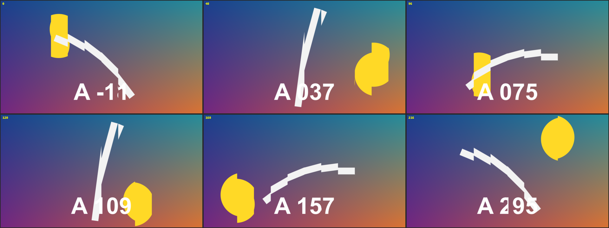
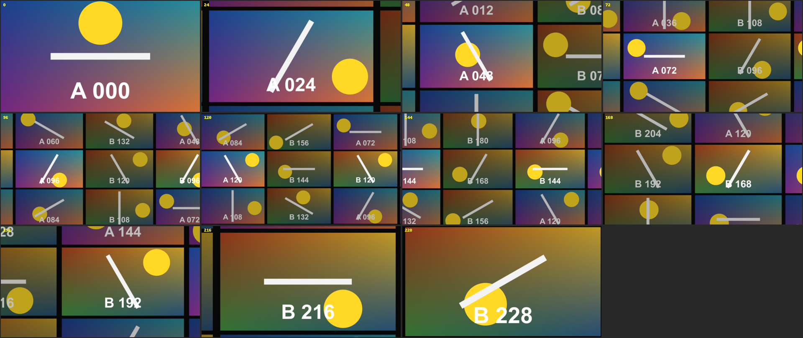
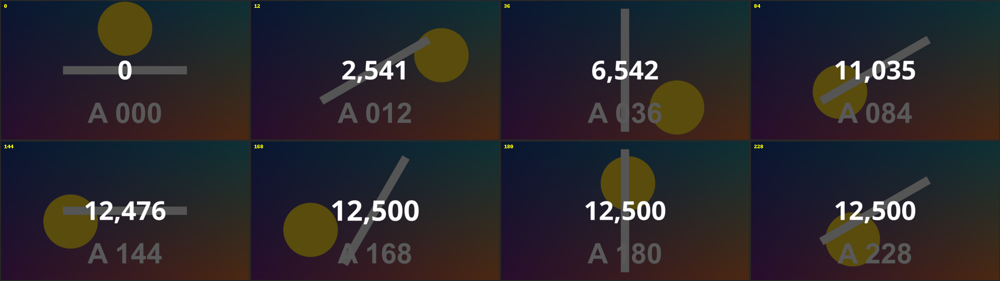

# resolve-fusion-templates

DaVinci Resolve 的 Fusion 範本：特效、轉場、標題。裝好之後會出現在 Edit 頁面的特效庫，拖到時間軸上就能用，參數在 Inspector 調整。

在 Resolve 21 Studio（Windows）上製作。

## 範本

| 範本 | 類型 | 說明 |
|---|---|---|
| [Comic Intro](#comic-intro) | 標題 | 漫畫頁快速翻動，鏡頭從字裡拉遠，最後定格成紅框白字的標題 |
| [Comic Intro Video](#comic-intro-video) | 特效 | 同上，但每個漫畫格播的是片段裡不同時間點的畫面 |
| [Time Slice](#time-slice) | 特效 | 畫面切成直條，每條比隔壁晚幾格 |
| [Photo Stack](#photo-stack) | 特效 | 影片的幾個片刻變成照片滑到桌上，最後一張放大成全畫面 |
| [Video Wall](#video-wall) | 轉場 | 拉遠成一面影片牆，橫移，再推進下一段 |
| [Chapter Bar](#chapter-bar) | 標題 | 有章節的進度條 |
| [Number Counter](#number-counter) | 標題 | 數字跳動 |

三種類型的用法不同：

- **標題**：從特效庫拖到影片上方的軌道。
- **特效**：從特效庫拖到片段上。
- **轉場**：從特效庫拖到兩個片段的交界。

所有動畫都跟著片段長度伸縮：片段（或標題、轉場）拉多長，動畫就走多久。

預覽圖的輸入是程序產生的測試畫面。畫面上的數字是畫格編號，用來看出每一格取的是哪個時間點。

### Comic Intro

漫畫頁快速翻動，鏡頭從字裡拉遠，最後定格成紅框白字的標題。漫畫格裡是程序畫出來的圖案，不需要素材。


**用法**：拖到時間軸上，拉成想要的長度。

| 參數 | 作用 |
|---|---|
| `Text` | 標題文字 |
| `Font`、`Style` | 字型 |
| `Text Size`、`Text Color` | 文字大小與顏色 |
| `Box Color` | 文字底框的顏色 |
| `Box Padding X`、`Box Padding Y` | 底框在文字四周的留白，底框會自動貼合文字 |
| `Background Color` | 最後定格時的背景色 |
| `Frames Per Page` | 每一頁停留幾格，數字越小翻得越快 |
| `Start Zoom` | 開頭放大幾倍 |
| `Zoom Pivot X`、`Zoom Pivot Y` | 鏡頭從畫面上哪一點拉遠 |

**注意**

- `Zoom Pivot` 要落在某個字母的筆畫上，開頭才會是「從字裡面看出去」。改了文字之後通常要跟著調。

### Comic Intro Video

和 Comic Intro 相同的動畫，但每個漫畫格播的是片段裡不同時間點的畫面。


**用法**：先把片段開頭切出想要的長度，再拖到那一段上。

| 參數 | 作用 |
|---|---|
| `Text` | 標題文字 |
| `Font`、`Style` | 字型 |
| `Text Size`、`Text Color` | 文字大小與顏色 |
| `Box Color` | 文字底框的顏色 |
| `Box Padding X`、`Box Padding Y` | 底框在文字四周的留白 |
| `Background Color` | 最後定格時的背景色 |
| `Page Count` | 整段總共翻幾頁 |
| `Halftone` | 漫畫網點的強度，0 是沒有 |
| `Start Zoom` | 開頭放大幾倍 |
| `Zoom Pivot X`、`Zoom Pivot Y` | 鏡頭從畫面上哪一點拉遠 |

**注意**

- 漫畫格取的是整支來源影片的畫面，不只是剪進時間軸的那一段。
- 動畫結束在標題畫面，不會接回原片。

### Time Slice

畫面切成直條，每條比隔壁晚幾格。畫面裡有東西在動時，動作會像波浪一樣掃過去。



**用法**：拖到片段上，整個片段都會套用。

| 參數 | 作用 |
|---|---|
| `Slices` | 切成幾條，2 到 16 |
| `Delay Per Slice` | 每條比前一條晚幾格 |
| `Horizontal Strips` | 改成橫條 |
| `From Center` | 中間最即時，往兩邊越來越晚 |
| `Reverse` | 延遲的方向反過來 |
| `Edge Softness` | 條與條之間的交界柔化 |

**注意**

- 畫面動得慢時效果不明顯，把 `Delay Per Slice` 調大。

### Photo Stack

影片的幾個片刻變成照片，一張張滑到桌上，最後一張放大成全畫面。


**用法**：先把片段開頭切出想要的長度，再拖到那一段上。最後一張照片就是片段本身正在播的畫面，放大之後會無縫接回原片。

| 參數 | 作用 |
|---|---|
| `Photo Count` | 照片張數，1 到 12 |
| `Slide Time` | 每張滑進來花多久。調大，同時在空中的照片就多 |
| `Stack Complete At` | 整疊在片段的哪個位置排完，之後開始放大 |
| `Layout Seed` | 換一種排法 |
| `Photos Play As Video` | 照片播影片還是定格 |
| `Stills From`、`Stills To` | 其他照片從來源影片的哪個範圍取 |
| `Photo Size`、`Spread`、`Tilt` | 照片大小、散開程度、傾斜程度 |
| `Border`、`Corner Roundness`、`Paper Color` | 白邊的寬度、圓角、顏色 |
| `Shadow`、`Shadow Softness`、`Shadow Distance` | 陰影的濃度、柔和度、距離 |
| `Motion Blur` | 滑動時的動態模糊 |
| `Backdrop Brightness`、`Backdrop Blur` | 背景的亮度與模糊，背景是片段本身的畫面 |

**注意**

- `Stills From`、`Stills To` 是以整支來源影片的比例計，不是剪進時間軸的那一段。
- 算圖偏慢，在 Edit 頁面不會即時播放。嫌慢先關 `Motion Blur`，再不行關 `Photos Play As Video`。

### Video Wall

從前一段拉遠，發現它只是一面影片牆裡的一格；鏡頭橫移，再推進另一格變成後一段。



**用法**：拖到兩個片段的交界，拉成想要的長度。

| 參數 | 作用 |
|---|---|
| `Pull Back` | 拉多遠。1 是剛好看到整面 3×3 的牆 |
| `Gap` | 螢幕之間的間隔 |
| `Time Offset` | 其他螢幕和主畫面差幾格 |
| `Other Screens Brightness` | 其他螢幕的亮度，調低可以突顯主畫面 |

**注意**

- 牆上其他螢幕顯示的是前一段較早、後一段較晚的畫面。出現黑色螢幕時把 `Time Offset` 調成 0。

### Chapter Bar

畫面底部的進度條，分成有名稱的章節，目前章節的名稱顯示在該段上方。


**用法**：拖到影片上方的軌道，拉到和整支影片一樣長。

| 參數 | 作用 |
|---|---|
| `Chapters` | 章節清單，一行一章，寫法見下方 |
| `Frame Rate Override` | 換章的時間點不對時，填上時間軸的影格率。0 是自動 |
| `Bar Color`、`Track Color`、`Track Opacity` | 已播放部分的顏色、底條的顏色與透明度 |
| `Bar Position`、`Bar Height`、`Side Margin` | 上下位置、粗細、左右留白 |
| `Chapter Gap` | 章節之間的缺口寬度，0 是一整條 |
| `Knob Size` | 進度位置那顆圓點的大小，0 是沒有 |
| `Show Chapter Name` | 是否顯示章節名稱 |
| `Name Font`、`Name Size`、`Name Color` | 名稱的字型、大小、顏色 |

章節清單和 YouTube 說明欄的寫法相同：

```
0:00 開場
1:25 第一段
4:10 第二段
9:30 結尾
```

每行開頭可以是下面三種，可以混用：

| 寫法 | 例子 | 說明 |
|---|---|---|
| 時間 | `1:25`、`1:02:03`、`0:07.5`、`42` | 從標題片段開頭算起，秒可以帶小數，會四捨五入到最近的一格 |
| 影格數 | `120f` | 精確到格 |
| 比例 | `25%` | 片段長度的百分比 |

**注意**

- 開頭不是這三種寫法的行會被略過；順序寫亂了會自動排好。
- 章節名稱不限數量，進度條上的缺口最多畫 19 個，也就是 20 章。超過的章節名稱照常切換，只是條上不再切開。
- 名稱的預設字型是微軟正黑體。換字型時要選有中文字的，不然中文會變成方塊。

### Number Counter

數字從一個值跳到另一個值，數完時彈一下。



**用法**：拖到影片上方的軌道，拉成想要的長度。背景是透明的。

| 參數 | 作用 |
|---|---|
| `Start Value`、`End Value` | 起始值與結束值 |
| `Decimals` | 小數位數，0 到 3 |
| `Thousands Separator` | 是否加千分位逗號 |
| `Prefix`、`Suffix` | 前後綴，例如 `$`、`%` |
| `Count Finishes At` | 在片段的哪個位置數完，之後停在結束值 |
| `Pop` | 數完時彈一下的幅度，0 是不彈 |
| `Font`、`Size`、`Color` | 字型、大小、顏色 |
| `Position` | 位置 |

**注意**

- 數字跳動時寬度會變。用每個數字等寬的字型（預設的 Open Sans 就是），文字才不會左右晃。

## 安裝

把 `templates/` 裡的 `.setting` 檔複製到 Resolve 的範本資料夾，依類型放進對應的子資料夾：

```
%APPDATA%\Blackmagic Design\DaVinci Resolve\Support\Fusion\Templates\Edit\
```

| 檔案 | 子資料夾 | 在特效庫的位置 |
|---|---|---|
| `Comic Intro.setting`、`Chapter Bar.setting`、`Number Counter.setting` | `Titles` | Titles → Fusion Titles |
| `Comic Intro Video.setting`、`Time Slice.setting`、`Photo Stack.setting` | `Effects` | Effects → Fusion Effects |
| `Video Wall.setting` | `Transitions` | Video Transitions → Fusion Transitions |

子資料夾不存在就自己建。Resolve 只在啟動時掃描這個資料夾，放進去之後要重啟才會出現。

移除時把檔案刪掉再重啟。

## 已知限制

- 這些範本都是在 Fusion 頁面的合成裡驗證的：能載入、算圖結果正確。從 Edit 頁面的特效庫拖到時間軸上這條路還沒有逐一實測。
- 參數裡的「片段的哪個位置」都是 0 到 1 的比例，不是秒數。

## 自己改範本

範本不是手動拉節點做的，是用腳本在執行中的 Resolve 裡建出節點圖，算圖檢查，再匯出打包。每個範本在 `scripts/` 裡有一支建置腳本，控制項清單也寫在裡面。

需要 Resolve Studio（免費版不開放外部腳本），並在偏好設定裡允許本機腳本。

做法、指令和踩過的坑都寫在 [skills/resolve-fusion/SKILL.md](skills/resolve-fusion/SKILL.md)，還沒整理的新發現在 [LEARNINGS.md](skills/resolve-fusion/LEARNINGS.md)。

## 結構

| 路徑 | 內容 |
|---|---|
| `templates/` | 範本檔（`.setting`） |
| `previews/` | 預覽圖 |
| `scripts/` | 建置、匯出、打包、驗證用的腳本 |
| `skills/resolve-fusion/` | 做法文件與學習記錄 |
