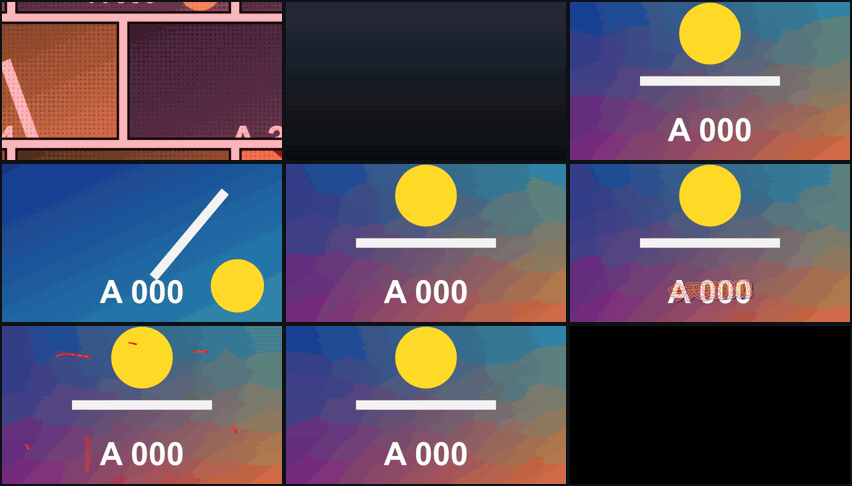

# resolve-fusion-templates

DaVinci Resolve 的 Fusion 範本：特效、轉場、標題。裝好之後會出現在 Edit 頁面的特效庫，拖到時間軸上就能用，參數在 Inspector 調整。

上圖由左到右、由上到下：Comic Intro、Photo Stack、Paper Tear、Video Wall、Freeze Frame、Variety Caption、Pen Mark、Zoom Callout、Split Screen。全部範本見[下方的列表](#範本)。

在 Resolve 21 Studio（Windows）上製作。只在這個環境試過：免費版和 Mac 能不能用，沒有測過。

## 關於這個專案

- **這些範本和腳本是讓 Claude（Anthropic 的 AI）做的。** 我負責提需求、看結果、決定要不要留；節點圖、運算式、建置腳本和說明文件都是它寫的。
- **這是我自己平常剪片在用的東西，順手分享出來。** 不是有人維護的產品。
- **不保證任何事。** 可能有錯，Resolve 改版後可能不能用，之後的版本也可能改掉參數名稱或行為、和舊版不相容。遇到問題歡迎開 issue 或自己改，但我不一定會回覆或處理。

## 範本

依用途分成七類。點範本名稱看預覽圖、用法和完整的參數說明。

### 開場

把影片的開頭做成一段有設計感的片頭。

| 範本 | 類型 | 說明 |
|---|---|---|
| [Comic Intro](docs/templates/comic-intro.md) | 特效 | 漫畫頁邊翻邊拉遠，退到發現它們在標題的筆畫裡，最後定格成紅框白字。漫畫格播的是片段裡不同時間點的畫面 |
| [Photo Stack](docs/templates/photo-stack.md) | 特效 | 影片的幾個片刻變成照片滑到桌上，最後一張才是正片，放大成全畫面後無縫接下去 |

### 強調與節奏

套在片段上，讓畫面在某些時刻更有力道。

| 範本 | 類型 | 說明 |
|---|---|---|
| [Punch Zoom](docs/templates/punch-zoom.md) | 特效 | 在指定的時間點或照拍子推近再彈回，可加 RGB 分離、模糊、震動、閃白 |
| [Time Slice](docs/templates/time-slice.md) | 特效 | 畫面切成直條，每條比隔壁晚幾格，動作像波浪一樣掃過去 |
| [Glitch Hits](docs/templates/glitch-hits.md) | 特效 | 在指定的時間點畫面像訊號不良一樣碎掉一下，也可以隨機出現 |
| [Freeze Frame](docs/templates/freeze-frame.md) | 特效 | 在指定的時間點停格，閃一下、推近、變色，像電影停下來介紹角色 |
| [Echo](docs/templates/echo.md) | 特效 | 會動的東西後面拖著幾個逐漸變淡的殘影 |
| [Spotlight](docs/templates/spotlight.md) | 特效 | 只有一塊保持原樣，其他地方變暗、變糊或變灰，也可以當放大鏡 |
| [Handmade](docs/templates/handmade.md) | 特效 | 動作一格一格跳、位置會抖、有紙的紋理，像手工做的動畫 |

### 轉場

放在兩個片段的交界。

| 範本 | 類型 | 說明 |
|---|---|---|
| [Paper Tear](docs/templates/paper-tear.md) | 轉場 | 前一段像紙一樣被撕成兩半拉開，露出後一段 |
| [Video Wall](docs/templates/video-wall.md) | 轉場 | 拉遠成一面有圓角螢幕的影片牆，傾斜著橫移，再推進下一段 |
| [Whip Pan](docs/templates/whip-pan.md) | 轉場 | 鏡頭甩開，畫面拉成一道模糊，停下來時是下一段 |
| [Zoom Through](docs/templates/zoom-through.md) | 轉場 | 往前一段裡面衝進去，衝出來是下一段 |
| [Stripe Wipe](docs/templates/stripe-wipe.md) | 轉場 | 幾條純色的色帶依序掃過畫面，掃完換成下一段 |
| [Glitch Cut](docs/templates/glitch-cut.md) | 轉場 | 畫面像訊號不良一樣碎掉，恢復時是下一段 |

### 綜藝字幕

綜藝節目常見的字卡、效果符號和子畫面。疊在影片上方的軌道，背景透明。

| 範本 | 類型 | 說明 |
|---|---|---|
| [Variety Caption](docs/templates/variety-caption.md) | 標題 | 厚描邊的綜藝字卡，標起來的詞放大換色。一個片段放很多句，用關鍵幀換句 |
| [Side Note](docs/templates/side-note.md) | 標題 | 歪歪的吐槽小字，加一支手繪箭頭指向畫面上的東西 |
| [Text Label](docs/templates/text-label.md) | 標題 | 文字加自動貼合的外框，九種形狀。通用的積木，疊幾個就能拼出主題框、人名條、對話泡泡 |
| [Reaction Mark](docs/templates/reaction-mark.md) | 標題 | 怒氣記號、汗滴、問號、驚嘆號、集中線 |
| [Hidden Word](docs/templates/hidden-word.md) | 標題 | 字幕裡一個詞先被貼紙蓋住，到時間貼紙掉下來，答案彈出來 |
| [Sub Window](docs/templates/sub-window.md) | 特效 | 把上層軌道的片段縮成帶外框和陰影的小窗，放反應畫面、相片、截圖用。七種外框（拍立得、視窗、手機、膠帶、底片等），可以放大成全畫面 |
| [Sticker Pop](docs/templates/sticker-pop.md) | 特效 | 去背的圖片彈進來、停留時輕輕晃動、再彈走，可加貼紙白邊和陰影 |

### 標記與說明

在畫面上圈東西、指東西、遮東西。教學和螢幕錄影常用。

| 範本 | 類型 | 說明 |
|---|---|---|
| [Pen Mark](docs/templates/pen-mark.md) | 標題 | 手繪的圈、底線、螢光筆、方框、箭頭、打勾、打叉，一筆一筆畫出來 |
| [Step Badge](docs/templates/step-badge.md) | 標題 | 彈出來的圓形編號，說明文字放在從徽章後面滑出來的膠囊裡 |
| [Dimension Line](docs/templates/dimension-line.md) | 標題 | 兩點之間的尺寸線，兩端有記號，旁邊有標示 |
| [Click Ripple](docs/templates/click-ripple.md) | 標題 | 從一個點擴散出去的圓圈，標示滑鼠點擊。一條標題可以標完整段錄影 |
| [Zoom Callout](docs/templates/zoom-callout.md) | 特效 | 圈住一個小地方，拉線到旁邊的視窗，視窗裡是放大後的樣子 |
| [Censor Patch](docs/templates/censor-patch.md) | 特效 | 把一塊畫面打馬賽克、模糊或蓋上色塊 |

### 畫面版面

改變整個畫面的配置。

| 範本 | 類型 | 說明 |
|---|---|---|
| [Letterbox](docs/templates/letterbox.md) | 標題 | 會滑進滑出的電影黑邊 |
| [Split Screen](docs/templates/split-screen.md) | 特效 | 幾個片段各佔畫面的一格，分隔線可以是斜的 |
| [Rec Frame](docs/templates/rec-frame.md) | 標題 | 攝影機觀景窗：四角框線、REC 紅點、時間碼、電池 |

### 文字與資訊

疊在影片上方的軌道，背景透明。

| 範本 | 類型 | 說明 |
|---|---|---|
| [Kinetic Lines](docs/templates/kinetic-lines.md) | 標題 | 一行行文字彈出來，照寫好的時間或照關鍵幀換句。也可以讓前面的行留著，變成逐條出現的條列 |
| [Number Counter](docs/templates/number-counter.md) | 標題 | 數字從一個值跳到另一個值，或當計次器，每到一個時間點加一 |
| [Bar Chart](docs/templates/bar-chart.md) | 標題 | 橫向長條圖，長條依序長出來，數字跟著跳 |
| [Chapter Bar](docs/templates/chapter-bar.md) | 標題 | 有章節名稱的進度條 |
| [Karaoke Caption](docs/templates/karaoke-caption.md) | 標題 | 字幕從左到右填上另一個顏色，跟著講話的速度走 |
| [Countdown](docs/templates/countdown.md) | 標題 | 倒數計時的時鐘和圓環，最後幾秒變色跳動 |

### 對話與社群

打字、留言、聊天、訂閱按鈕這類畫面。疊在影片上方的軌道，背景透明。

| 範本 | 類型 | 說明 |
|---|---|---|
| [Typing](docs/templates/typing.md) | 標題 | 文字一個字一個字打出來，後面跟著游標，可以倒著刪掉再換下一句 |
| [Comment Card](docs/templates/comment-card.md) | 標題 | 一張留言卡：頭像、名字、內文、會往上跳的愛心數。也可以當通知橫幅 |
| [Chat Bubbles](docs/templates/chat-bubbles.md) | 標題 | 聊天對話：訊息一則則彈出來把舊的往上推，可以放「輸入中」的三個點 |
| [Subscribe Reminder](docs/templates/subscribe-reminder.md) | 標題 | 按讚、訂閱、開啟小鈴鐺：一排按鈕彈出來，依序被按下 |

預覽圖的輸入是程序產生的測試畫面。畫面上的數字是畫格編號，用來看出每一格取的是哪個時間點。

## 文件

| 文件 | 內容 |
|---|---|
| [安裝與移除](docs/install.md) | 範本包、安裝程式、手動安裝、移除，三種類型各自怎麼拖 |
| [時間清單的寫法](docs/time-list.md) | Chapter Bar、Kinetic Lines、Punch Zoom、Variety Caption、Side Note、Glitch Hits、Freeze Frame、Karaoke Caption、Number Counter、Typing、Chat Bubbles 共用的時間點寫法 |
| [docs/templates/](docs/templates) | 每個範本一份：預覽圖、用法、參數、注意事項 |
| [做法與踩過的坑](skills/resolve-fusion/SKILL.md) | 這些範本是怎麼用腳本做出來的，想自己改範本時看這份 |

## 快速安裝

1. 下載 [Resolve-Fusion-Templates.drfx](https://github.com/ChingJe/resolve-fusion-templates/releases/latest/download/Resolve-Fusion-Templates.drfx)，所有範本都包在這一個檔裡。
2. 開著 Resolve，對它點兩下，按 **Install**。
3. 到 Edit 頁面的 Effects 特效庫找範本。

Windows 和 Mac 都是這樣裝。Windows 上試過，裝完不用重啟就能用；Mac 因為手邊沒有機器，沒有實際試過。

下載了整個儲存庫的人也可以執行 `install.bat`（只有 Windows），它會把 `templates/` 裡的原始檔一個個裝進去。兩種方式擇一，不要混用。

細節和手動安裝的方式見[安裝與移除](docs/install.md)。

## 已知限制

- **只在 Studio 版試過。** 安裝和使用範本理論上不需要 Studio 版的功能，但沒有在免費版上實際裝過。自己改範本用的建置腳本則一定要 Studio 版。
- **中文範本預設用「微軟正黑體」（Microsoft JhengHei）**，這是 Windows 內建的字型。電腦上沒有這個字型時（例如 Mac），文字可能變成方塊或換成別的字型，請在範本的 `Font` 參數改成你有的中文字型。Fusion 的文字不會自動替換缺字的字型，所以選了沒有中文的字型，中文一樣會變方塊。
- 這些範本都是在 Fusion 頁面的合成裡驗證的：能載入、算圖結果正確。從 Edit 頁面的特效庫拖到時間軸上只抽了幾個試過（能用），還沒有逐一實測。
- 參數裡的「片段的哪個位置」都是 0 到 1 的比例，不是秒數。

## 自己改範本

範本不是手動拉節點做的，是用腳本在執行中的 Resolve 裡建出節點圖，算圖檢查，再匯出打包。每個範本在 `scripts/` 裡有一支建置腳本，控制項清單也寫在裡面。

需要 Resolve Studio（免費版不開放外部腳本），並在偏好設定裡允許本機腳本。

做法、指令和踩過的坑都寫在 [skills/resolve-fusion/SKILL.md](skills/resolve-fusion/SKILL.md)，還沒整理的新發現在 [LEARNINGS.md](skills/resolve-fusion/LEARNINGS.md)。

## 授權

[MIT](LICENSE)。範本和腳本可以自由使用、修改、再散佈，再散佈時保留授權條文即可。

**用這些範本做出來的影片不需要標示出處**，可以用在任何用途，包含商業用途。

本專案與 Blackmagic Design 無關，也沒有得到它的認可。DaVinci Resolve 和 Fusion 是 Blackmagic Design Pty. Ltd. 的商標。

## 結構

| 路徑 | 內容 |
|---|---|
| `install.bat` | 安裝、更新、移除範本 |
| `templates/` | 範本檔（`.setting`），依類型分成 `Titles`、`Effects`、`Transitions` |
| `docs/` | 每個範本的說明、安裝方式、時間清單的寫法 |
| `previews/` | 預覽圖 |
| `scripts/` | 建置、匯出、打包、驗證用的腳本 |
| `skills/resolve-fusion/` | 做法文件與學習記錄 |
