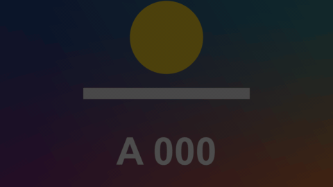

# Bar Chart

標題 · 檔案 `templates/Titles/Bar Chart.setting` · [回到總覽](../../README.md)

橫向長條圖。長條一條接一條長出來，每條左邊是名稱，右邊的數字跟著長條一起從 0 跳到最終值。最長的那條佔滿可用寬度，其他按比例。



上面那張是自動的：長條照固定節奏依序長出來。下面那張用 `Bars Shown` 打關鍵幀：長一條、停、一口氣長兩條、停、長最後一條。

**用法**：拖到影片上方的軌道，拉成想要的長度。背景是透明的。

| 參數 | 作用 |
|---|---|
| `Rows` | 資料，一行一條，寫法見下方 |
| `Sort Largest First` | 依數值由大到小排，不勾就照你寫的順序 |
| `Highlight Largest` | 數值最大的那條用另一個顏色 |
| `Bar Color`、`Highlight Color` | 長條的顏色、最大那條的顏色 |
| `Grow Time` | 每條長出來花多久，以片段長度的比例計 |
| `All Done At` | 最後一條在片段的哪個位置長完。和 `Grow Time` 差距越大，各條錯開得越開 |
| `Set The Timing By Hand` | 勾選後不看 `Grow Time` 和 `All Done At`，改看下面的 `Bars Shown` |
| `Bars Shown` | 目前長到第幾條，在這裡打關鍵幀。2 是前兩條長完，2.5 是第三條長到一半。數字往回，長條就縮回去 |
| `Bounce` | 長到底時衝過頭再回來的幅度，0 是不彈 |
| `Decimals` | 數字的小數位數，0 到 3 |
| `Prefix`、`Suffix` | 數字的前後綴，例如 `$`、`%`、` 萬` |
| `Position`、`Chart Width`、`Chart Height` | 整張圖的位置與大小 |
| `Name Column Width`、`Number Column Width` | 左邊留給名稱、右邊留給數字的寬度。字被切到或疊到長條時調大 |
| `Bar Thickness` | 長條的粗細，1 是條與條之間沒有空隙 |
| `Text Gap` | 文字和長條之間的間隔 |
| `Text Size` | 名稱和數字的大小 |
| `Name Font`、`Name Color` | 名稱的字型與顏色 |
| `Number Font`、`Number Color` | 數字的字型與顏色 |

每行寫名稱，空一格，再寫數值。名稱裡可以有空格，一行的最後一段會被當成數值：

```
蘋果 42
香蕉 28
紅 蘋果 35.5
```

**注意**

- `Bars Shown` 只在實驗用的合成裡用腳本打關鍵幀測過，沒有在 Edit 頁面的檢查器裡實際操作過。

- 最多八條，超過的行會被略過。結尾不是數字的行也會被略過。
- 數值不要寫千分位逗號，寫 `12500`，顯示時會自動加上。負數會當成 0。
- 長條的高度是 `Chart Height` 除以條數，條數少的時候每條會比較粗，可以把 `Chart Height` 調小。
- 數值是固定的，長完就停住，不是長條會互相超車的排名動畫。
- 預設字型是微軟正黑體。換字型時要選有中文字的，不然中文會變成方塊。
