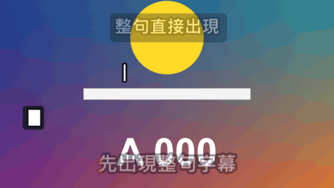

# Caption

標題 · 檔案 `templates/Titles/Caption.setting` · [回到總覽](../../README.md)

一次顯示一句的字幕，照時間換句。每一句有三種出現方式：整句直接出現、一個字一個字打出來（後面跟著游標）、從左到右填上另一個顏色（像卡拉 OK 的歌詞）。

圖上四個各是一種設定，由上到下：整句出現加底框、打字、方塊游標加倒著刪除（從左邊開始打）、填色。

這個範本取代了原本的 Typing 和 Karaoke Caption 兩個範本，字的外觀設定和其他文字類標題是同一組。

**用法**：拖到影片上方的軌道，拉成想要的長度。背景是透明的。在 `Lines` 裡一行寫一句，前面加時間，再用 `The Words` 選出現方式。

| 參數 | 作用 |
|---|---|
| `Lines` | 清單，一行一句，前面是這一句開始的時間，例如 `0:02 今天要挑戰` |
| `Lines Start With A Time` | 取消勾選後清單不用寫時間，改成在 `Line Number` 打關鍵幀換句 |
| `Line Number` | 不寫時間時用：打關鍵幀 1、2、3 決定現在是第幾句 |
| `Frame Rate Override` | 時間點或速度不對時，填上片段的影格率。0 是自動 |
| `The Words` | 出現方式：`Appear At Once` 整句直接出現、`Are Typed Out` 一個字一個字打出來、`Fill With A Second Colour` 整句先出現再從左到右填色 |
| `Characters Per Second` | 打字或填色每秒幾個字。0 是自動：配合這一句的時間長度 |
| `Typing Or Filling Is Done At` | 自動模式下，在這一句時間的幾成處打完或填完。0.75 是留 25% 的時間停在完成的狀態 |
| `Fill One Character At A Time` | 填色時勾選是一個字一個字跳，不勾是平滑地掃過去 |
| `At The End Of A Typed Line` | 打字時一句結束的方式：`It Stays Until The Next One` 留到下一句直接換掉，`It Is Deleted Backwards` 倒著一個字一個字刪掉，剛好在下一句開始前刪完 |
| `Deleted Characters Per Second` | 倒著刪的速度 |
| `Cursor Of A Typed Line` | 打字時的游標：`Bar` 直線、`Block` 方塊、`Underline` 底線、`None` 沒有 |
| `Cursor Blinks Per Second` | 停下來時游標每秒閃幾次，0 是不閃。正在打字或刪除時游標不閃 |
| `Position` | 位置 |
| `Position Is` | `Position` 指的是哪裡：`Where The Line Starts` 這一句的開頭、`The Middle Of The Line` 整句的正中央、`The Middle Of What Is Typed So Far` 打字時目前打出來的字的正中央（每多一個字整行就往左移一點） |
| `Pop Frames` | 整句出現和填色時，每句出現的那一下彈一下，花幾格。打字時沒有作用 |
| `Fade Out Frames` | 換句前花幾格淡出，0 是直接換 |
| `Font` 到 `Box Roundness` | 字的外觀：字型、字級、字距、顏色、兩層描邊、陰影、底框。和其他文字類標題是同一組，見[文字外觀](../text-style.md) |
| `Fill Colour` | 填色時已經填的字的顏色 |
| `Outline Colour Of The Filled Part` | 填色時已經填的字的描邊顏色 |

時間點可以寫成 `1:25`、`120f`、`25%` 三種，從片段開頭算起，詳見[時間清單的寫法](../time-list.md)。

**注意**

- 只在實驗用的合成裡用腳本測過，還沒有從 Edit 頁面拖進時間軸試過。
- 範本不會聽聲音。打字和填色的速度是平均分配的，講話忽快忽慢時對不準；要對得準，就把一句拆成幾行，各自寫時間。
- 一句只能有一行，太長會超出畫面，要自己斷句。
- 空白也算一個字，打到或填到空白時會停一格的時間。
- 打字時底框從句子開頭到游標，會跟著字變長；另外兩種方式底框包住整句。
- 游標和字是同一個顏色。
- 用關鍵幀換句時，一句最長只能往後看 60 格來判斷這一句有多長，所以自動速度和倒著刪除在長句子上會不準，改用 `Characters Per Second` 指定速度，或改用寫時間的清單。
- 預設字型是微軟正黑體粗體。換字型時要選有中文字的，不然中文會變成方塊。
