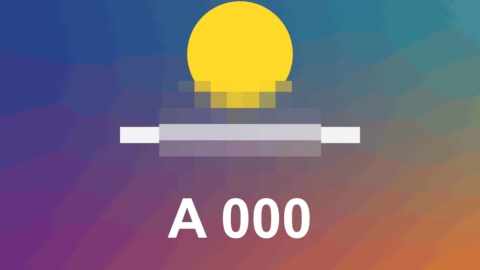

# Censor Patch

特效 · 檔案 `templates/Effects/Censor Patch.setting` · [回到總覽](../../README.md)

把畫面上的一塊遮起來：馬賽克、模糊，或直接蓋一塊顏色。用在人臉、車牌、螢幕上不想被看到的資料。也可以反過來，只留那一塊、其他全遮。

**用法**：拖到片段上，在 `Style` 選遮法，用 `Position`、`Width`、`Height` 蓋住要遮的地方。同一個片段要遮兩個地方，就套兩次。

| 參數 | 作用 |
|---|---|
| `Style` | `Mosaic` 馬賽克、`Blur` 模糊、`Colour Block` 色塊（預設黑色，就是黑條） |
| `Shape` | `Rectangle` 矩形、`Ellipse` 橢圓 |
| `Position` | 遮蔽區的中心 |
| `Width`、`Height` | 遮蔽區的寬和高，都以畫面高度為 1 |
| `Angle` | 旋轉角度 |
| `Rectangle: Corner Roundness` | 矩形的圓角，0 是直角，1 是兩端全圓 |
| `Mosaic: Cell Size` | 馬賽克一格多大。太小會看得出原本的內容 |
| `Blur: Strength` | 模糊的程度 |
| `Colour Block: Colour` | 色塊的顏色 |
| `Edge Softness` | 遮蔽區邊緣的柔和度，0 是銳利的邊 |
| `Hide Everything Else Instead` | 勾起來變成只有這一塊是清楚的，其他地方都遮 |
| `Fade In (seconds)`、`Fade Out (seconds)` | 開頭和結尾各花幾秒漸入、漸出，0 是沒有 |
| `Frame Rate Override` | 秒數算得不對時填時間軸的影格率，平常留 0 |

**注意**

- **不會自動追蹤。** 人或東西會動的話，要在 `Position`（必要時加上 `Width`、`Height`）打關鍵幀跟著走，動得多就要打很多格。
- 真的要保護隱私時，馬賽克的格子要夠大、模糊要夠強，而且每一格都要檢查有沒有漏掉。最保險的是 `Colour Block`。
- 也可以套在調整片段上，一次遮住底下好幾個片段。這個用法沒有實際測過。
