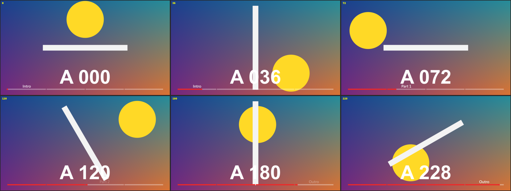

# Chapter Bar

標題 · 檔案 `templates/Chapter Bar.setting` · 安裝到 `Titles` · [回到總覽](../../README.md)

畫面底部的進度條，分成有名稱的章節，目前章節的名稱顯示在該段上方。



**用法**：拖到影片上方的軌道，拉到和整支影片一樣長。

| 參數 | 作用 |
|---|---|
| `Chapters` | 章節清單，一行一章，寫法見下方 |
| `Frame Rate Override` | 換章的時間點不對時，填上時間軸的影格率。0 是自動 |
| `Bar Color`、`Track Color`、`Track Opacity` | 已播放部分的顏色、底條的顏色與透明度 |
| `Bar Position`、`Bar Height`、`Side Margin` | 上下位置、粗細、左右留白 |
| `Chapter Gap` | 章節之間的缺口寬度，0 是一整條 |
| `Knob Size` | 進度位置那顆圓點的大小，0 是沒有 |
| `Show Chapter Name` | 是否顯示章節名稱 |
| `Name Font`、`Name Size`、`Name Color` | 名稱的字型、大小、顏色 |

章節清單和 YouTube 說明欄的寫法相同：

```
0:00 開場
1:25 第一段
4:10 第二段
9:30 結尾
```

每行開頭寫時間，後面寫章節名稱。時間可以寫成 `1:25`、`120f`、`25%` 三種，詳見[時間清單的寫法](../time-list.md)。

**注意**

- 章節名稱不限數量，進度條上的缺口最多畫 19 個，也就是 20 章。超過的章節名稱照常切換，只是條上不再切開。
- 名稱的預設字型是微軟正黑體。換字型時要選有中文字的，不然中文會變成方塊。
