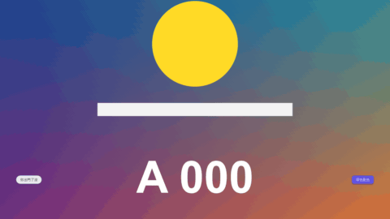

# Chat Bubbles

標題 · 檔案 `templates/Titles/Chat Bubbles.setting` · [回到總覽](../../README.md)

一段聊天對話。訊息一則則從底下彈出來，把前面的往上推，最舊的淡出。對方的在左邊、自己的在右邊，各一種顏色。清單裡還可以放「對方正在輸入」的三個點。



圖上三段對話各是一種配色：`Blue And Grey`、`Green And White`、`Dark`（圓角調小、只留三則）。

**用法**：拖到影片上方的軌道，拉成想要的長度。背景是透明的。在 `Messages` 裡一行寫一則訊息：

```
0:00 < 你出門了沒
0:01.2 > ...
0:02.2 > 快到了
0:04 < 你一小時前也這樣說\n我都吃完了
```

- 開頭是這一則出現的時間。
- 接著是 `<`（對方，靠左）或 `>`（自己，靠右）。沒寫就當成 `<`。
- 再來是內容。內容只寫 `...` 就是三個跳動的點，下一則出現時它會消失；下一則如果是同一邊的，看起來就像打完字送出。
- 一則訊息要分成兩行，在斷行的地方寫 `\n`。

| 參數 | 作用 |
|---|---|
| `Messages` | 訊息清單，寫法見上面 |
| `Rows Start With A Time` | 取消勾選後清單不用寫時間（`< 內容`），改成在 `Messages So Far` 打關鍵幀。見下面「用關鍵幀決定時間」 |
| `Messages So Far` | 不寫時間時用：打關鍵幀 1、2、3 決定清單已經出現到第幾行 |
| `Frame Rate Override` | 時間點不對時，填上片段的影格率。0 是自動 |
| `Position` | 最新那一則訊息的底邊在哪裡。對話從這裡往上長 |
| `Width Of The Conversation` | 對話的寬度（畫面寬為 1）。左邊的訊息貼左緣，右邊的貼右緣 |
| `Font` | 字型和字重 |
| `Size` | 字級，泡泡跟著等比例縮放 |
| `Messages Kept On Screen` | 畫面上最多留幾則，1 到 6。再舊的會在被推上去時淡出 |
| `Bubble Padding` | 泡泡在字四周的留白 |
| `Space Between Messages` | 訊息之間的距離 |
| `Roundness` | 泡泡的圓角，1 是膠囊形 |
| `Pop Frames` | 新訊息彈出來、舊訊息往上推，花幾格 |
| `Shadow` | 泡泡陰影的濃度，0 是沒有 |
| `Fade Out Frames At The End` | 片段結尾整段對話淡出花幾格，0 是不淡出 |
| `Colours` | 配色：`Blue And Grey`、`Green And White`、`Dark`，或 `Custom` 自己選 |
| `Custom …` 四個顏色 | `Colours` 選 `Custom` 時才有作用：對方的泡泡和字、自己的泡泡和字 |

時間點可以寫成 `1:25`、`120f`、`25%` 三種，從片段開頭算起，詳見[時間清單的寫法](../time-list.md)。清單要照時間先後寫。

## 用關鍵幀決定時間

不想寫時間的話，可以改成用關鍵幀決定每一則什麼時候出現。

1. 取消勾選 `Rows Start With A Time`。
2. `Messages` 清單不寫時間，一行一則：

```
< 你出門了沒
> ...
> 快到了
< 你一小時前也這樣說
```

3. 在 `Messages So Far` 打關鍵幀，數字是「清單已經出現到第幾行」：片段開頭填 0（還沒有訊息），第一則要出現的地方填 1，第二則填 2，依此類推。

- 數字是幾就顯示前幾行，看的是數字本身。所以可以一次跳兩則，也可以往回填，訊息就會消失。
- 兩個關鍵幀之間的小數會被捨去：從 1 走到 2 的途中都算 1，到 2 的那一格第二則才出現。所以一個關鍵幀就是一則。
- 每一則彈出來的動畫從數字改變的那一格開始。
- `...`（正在輸入的三個點）也佔一行，要算進數字裡。
- 這個模式只在實驗用的合成裡用腳本打關鍵幀測過，沒有在 Edit 頁面的檢查器裡實際操作過。

**注意**

- 只在實驗用的合成裡用腳本測過，還沒有從 Edit 頁面拖進時間軸試過。
- 沒有頭像和名字，只分左右兩邊。要標出是誰，在旁邊疊一個 [Text Label](text-label.md)。
- 訊息不會自動換行，太長會超出對話的寬度，要自己用 `\n` 斷。
- 一則訊息的字是一個一個整則出現的，不會逐字打出來。要逐字打用 [Word By Word](word-by-word.md)。
- 算圖比一般標題慢，在 Edit 頁面可能不會即時播放。
- 樣式是通用的，沒有仿特定的 App。
- 預設字型是微軟正黑體。換字型時要選有中文字的，不然中文會變成方塊。
