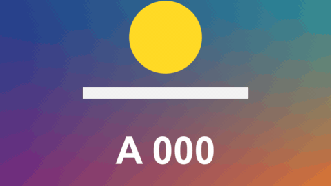

# Click Ripple

標題 · 檔案 `templates/Titles/Click Ripple.setting` · [回到總覽](../../README.md)

從一個點擴散出去的圓圈，螢幕錄影用來標示「滑鼠點了這裡」或「手指按了這裡」。

圖上是四個片段，放在不同的時間和位置，第二個是雙擊。

**用法**：拖到螢幕錄影上方的軌道，片段的開頭對準點擊的那一刻，把 `Position` 移到游標的位置。**一個片段點一次**，要標幾次點擊就放幾個片段（複製貼上、各自移位置最快）。

| 參數 | 作用 |
|---|---|
| `Position` | 點擊的位置 |
| `Clicks` | 連點幾下，2 就是雙擊 |
| `Seconds Between Clicks` | 連點時每一下隔多久 |
| `Size` | 波紋擴散到最大時的直徑，以畫面高度為 1 |
| `Ripple Lasts (seconds)` | 一次波紋從出現到消失多久 |
| `Rings` | 一次擴散幾圈，0 是不畫圈（只留圓盤和中心點） |
| `Ring Thickness` | 圈的粗細 |
| `Filled Disc` | 圈裡面填色的濃度，0 是不填 |
| `Centre Dot` | 中心實心點的大小，0 是沒有 |
| `Opacity` | 整體不透明度 |
| `Outline`、`Outline Colour` | 外面再包一圈別的顏色，0 是沒有 |
| `Colour` | 波紋的顏色 |

**注意**

- 只在實驗用的合成裡用腳本測過，還沒有從 Edit 頁面拖進時間軸試過。
- 原本「一條長標題用時間清單標完整段錄影」的用法拿掉了，改成一個片段點一次。
- 片段要比 `Ripple Lasts` 長，不然波紋還沒消失就被切掉。
- 連點三下時同一時間最多顯示兩個波紋，間隔比 `Ripple Lasts` 短很多的話，最早的那個會提早消失。
- 不會自動找游標，位置要自己設。
