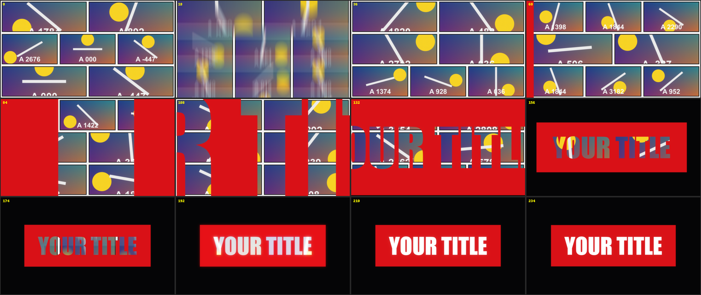

# Comic Intro Video

特效 · 檔案 `templates/Effects/Comic Intro Video.setting` · [回到總覽](../../README.md)

和 Comic Intro 相同的動畫，但每個漫畫格播的是片段裡不同時間點的畫面。

**用法**：先把片段開頭切出想要的長度，再拖到那一段上。

| 參數 | 作用 |
|---|---|
| `Text` | 標題文字 |
| `Font`、`Style` | 字型 |
| `Text Size`、`Text Color` | 文字大小與顏色 |
| `Box Color` | 文字底框的顏色 |
| `Box Padding X`、`Box Padding Y` | 底框在文字四周的留白 |
| `Background Color` | 最後定格時的背景色 |
| `Page Count` | 整段總共翻幾頁 |
| `Halftone` | 漫畫網點的強度，0 是沒有 |
| `Start Zoom` | 開頭放大幾倍 |
| `Zoom Pivot X`、`Zoom Pivot Y` | 鏡頭從畫面上哪一點拉遠 |

**注意**

- 漫畫格取的是整支來源影片的畫面，不只是剪進時間軸的那一段。
- 動畫結束在標題畫面，不會接回原片。
