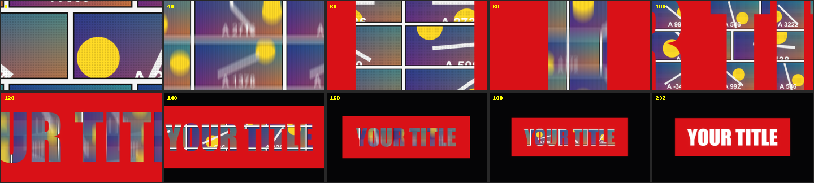

# Comic Intro

特效 · 檔案 `templates/Effects/Comic Intro.setting` · [回到總覽](../../README.md)

漫畫頁一頁頁往下翻，鏡頭同時不停往後拉。拉到一半會發現這些漫畫頁其實在標題的筆畫裡面，最後定格成紅框白字的標題。每個漫畫格播的是片段裡不同時間點的畫面。

**用法**：先把片段開頭切出想要的長度（3 到 5 秒左右），再拖到那一段上。動畫會隨片段長度伸縮。

| 參數 | 作用 |
|---|---|
| `Text` | 標題文字 |
| `Font`、`Style` | 字型 |
| `Text Size`、`Text Color` | 文字大小與顏色 |
| `Box Color` | 文字底框的顏色 |
| `Box Padding X`、`Box Padding Y` | 底框在文字四周的留白 |
| `Background Color` | 最後定格時的背景色 |
| `Page Count` | 整段總共翻幾頁 |
| `Pages Start Size` | 開頭漫畫頁放多大。數字越大，一開始貼得越近，只看到一兩格 |
| `Pages End Size` | 標題成形時漫畫頁縮到多小。數字越小，字裡面看到的格子越多越密 |
| `Halftone` | 漫畫網點的強度，0 是沒有 |
| `Start Zoom` | 標題開頭放大幾倍 |
| `Zoom Pivot X`、`Zoom Pivot Y` | 鏡頭從畫面上哪一點拉遠 |

**注意**

- `Zoom Pivot` 要落在某個字的筆畫裡面，開頭才會是整個畫面都在筆畫內、看到滿版的漫畫頁。預設值是替預設文字 `YOUR TITLE`（Impact 字型）算好的。換了文字或字型之後，如果開頭出現一片紅色，就微調這兩個數值，讓那一點移到筆畫上。
- `Pages Start Size` 和 `Pages End Size` 設成一樣，漫畫頁就不會縮放，只有翻頁。
- 漫畫格取的是整支來源影片的畫面，不只是剪進時間軸的那一段。
- 動畫結束在標題畫面，不會接回原片。
