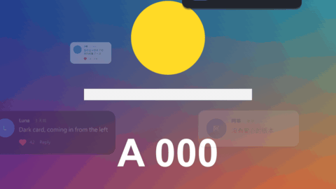

# Comment Card

標題 · 檔案 `templates/Titles/Comment Card.setting` · [回到總覽](../../README.md)

一張留言卡：圓形頭像（裡面是名字的第一個字）、名字、時間、內文、愛心和數字。也可以切成通知的樣子：方形圖示、標題、右上角的時間、內文。卡片的大小會自動配合寫的字。

圖上四張各是一種設定：亮色留言（愛心數會往上跳）、從上面滑下來的深色通知、從左邊進來的深色留言、沒有愛心的淡入留言。

**用法**：拖到影片上方的軌道，拉成要顯示的長度，填名字和內文，移動 `Position`。背景是透明的。

| 參數 | 作用 |
|---|---|
| `Kind` | `Comment` 留言：圓形頭像，時間接在名字後面，下面有愛心。`Notification` 通知：方形圖示，時間靠右，沒有愛心 |
| `Name` | 名字（通知的話是 App 或標題）。頭像裡的字是它的第一個字 |
| `When` | 名字旁邊的小字，例如 `2 小時前`、`現在`。留空就不顯示 |
| `Words` | 內文，可以多行。不會自動換行，要自己斷 |
| `Heart And Number` | 要不要顯示愛心那一列 |
| `Likes` | 愛心旁邊的數字 |
| `Likes Grow To` | 填一個比 `Likes` 大的數字，數字就會在片段期間從 `Likes` 跳到這個數。0 是不動 |
| `After The Number` | 數字後面的字，預設是 `回覆`。留空就不顯示 |
| `Position` | 卡片中心的位置 |
| `Font` | 字型。名字和頭像裡的字固定用粗體 |
| `Size` | 內文的字級，其他東西跟著等比例縮放 |
| `Narrowest Card` | 卡片最窄的寬度（畫面寬為 1）。字比較多時卡片會自己變寬 |
| `Padding`、`Roundness` | 卡片四周的留白、圓角 |
| `Shadow` | 卡片陰影的濃度，0 是沒有 |
| `Entrance` | 進場：`Pop` 彈出、`From Left`／`From Right` 從旁邊滑一小段進來、`From Below`／`From Above` 從畫面外滑進來、`Fade` 淡入、`None` 直接出現 |
| `Entrance Frames` | 進場花幾格 |
| `Leave The Same Way At The End`、`Leave Frames` | 片段結尾用同樣的方式離開，花幾格 |
| `Colours` | 配色：`Light` 亮色、`Dark` 深色，或 `Custom` 自己選 |
| `Picture Colour` | 頭像（圖示）的顏色。不受 `Colours` 影響，每個人可以給不同的顏色 |
| `Custom …` 四個顏色 | `Colours` 選 `Custom` 時才有作用：卡片、字、小字、愛心 |

**注意**

- 只在實驗用的合成裡用腳本測過，還沒有從 Edit 頁面拖進時間軸試過。
- 頭像是色塊加一個字，不能放圖片。要放真的頭像，在上方軌道疊一張圖，用 [Sticker Pop](sticker-pop.md) 或 [Sub Window](sub-window.md) 讓它一起進場。
- 一個片段是一張卡片。要一張接一張，就排好幾個片段；通知要連續跳出來也是一樣。
- 數字會加千分位的逗號（`5,200`），不會變成「5.2 千」或「1.2 萬」。
- 樣式是通用的，沒有仿特定的網站或 App。
- 預設字型是微軟正黑體。換字型時要選有中文字、而且有 `Regular` 和 `Bold` 兩種字重的，不然中文會變成方塊，或粗體沒有作用。
