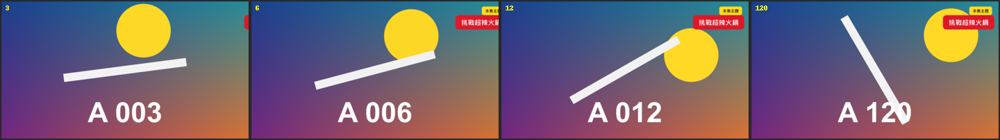

# Corner Tag

標題 · 檔案 `templates/Titles/Corner Tag.setting` · [回到總覽](../../README.md)

釘在畫面角落的主題框：上面一個小標籤（例如「本集主題」），下面一行比較大的字，各有自己的底框。開頭從側邊滑進來，結尾可以再滑出去。

**用法**：拖到影片上方的軌道，拉成要顯示的長度，通常是整段影片。底框會自動貼合文字的長度。

| 參數 | 作用 |
|---|---|
| `Label` | 上面的小標籤。留空就只有下面那一行 |
| `Text` | 主要的文字 |
| `Corner` | 放在哪個角落：左上、右上、左下、右下 |
| `Margin X`、`Margin Y` | 離畫面邊緣多遠 |
| `Font`、`Size` | 字型、主要文字的大小 |
| `Label Size` | 小標籤相對於主要文字的大小 |
| `Text Color`、`Box Color` | 主要文字和它底框的顏色 |
| `Label Text Color`、`Label Box Color` | 小標籤和它底框的顏色 |
| `Box Padding X`、`Box Padding Y` | 底框在文字四周的留白 |
| `Box Roundness` | 底框圓角的程度 |
| `Shadow` | 陰影的濃度 |
| `Slide In Frames` | 滑進來花幾格 |
| `Slide Out At The End` | 片段結尾要不要滑出去 |
| `Slide Out Frames` | 滑出去花幾格 |

**注意**

- 在右邊的角落，文字的尾端對齊邊距；在左邊的角落，文字的開頭對齊邊距。底框會比文字再多出一圈留白，所以 `Margin` 設太小時底框會貼到畫面邊緣。
- 預設字型是微軟正黑體粗體。換字型時要選有中文字的。
