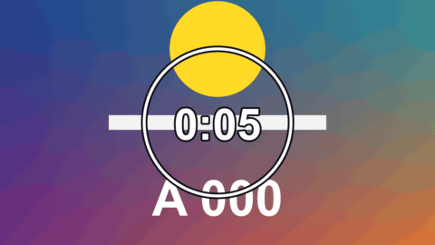

# Countdown

標題 · 檔案 `templates/Titles/Countdown.setting` · [回到總覽](../../README.md)

倒數計時的時鐘，照真實的秒數走到 0，外面可以有一圈跟著變短的圓環。最後幾秒會變色，每秒脹一下。也可以改成正數。

**用法**：拖到影片上方的軌道，拉成想要的長度。背景是透明的。預設是倒數整個片段的長度，片段拉多長就倒數多久。

| 參數 | 作用 |
|---|---|
| `Seconds` | 從幾秒開始倒數。0 是用片段的長度，剛好在片段結束時數到 0 |
| `Count Up` | 改成從 0 往上數 |
| `Format` | 顯示格式：`0:10`、`10`、`10.0`、`00:10.00` |
| `Frame Rate Override` | 走得太快或太慢時，填上片段的影格率。0 是自動 |
| `Font` | 字型和字重 |
| `Position`、`Size` | 位置和字的大小 |
| `Ring Thickness` | 圓環的粗細，0 是不要圓環 |
| `Ring Size` | 圓環的直徑，以畫面高度為 1 |
| `Ring Track Opacity` | 圓環已經走完的部分留多少透明度 |
| `Outline`、`Outline Colour` | 描邊的粗細和顏色 |
| `Warn In The Last` | 最後幾秒進入警告狀態，0 是關閉 |
| `Throb` | 警告狀態下每秒脹一下的幅度 |
| `Colour`、`Warning Colour` | 平常和警告狀態的顏色 |

**注意**

- 整數格式是無條件進位，所以倒數 10 秒時，第一秒顯示 10，數到 0 的那一刻才顯示 0。
- 數字的寬度不同時整串會左右晃，用數字等寬的字型（預設的 Arial 就是）可以避免。
