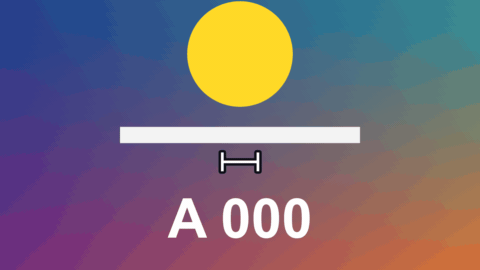

# Dimension Line

標題 · 檔案 `templates/Titles/Dimension Line.setting` · [回到總覽](../../README.md)

兩點之間的一條線，兩端有記號，旁邊有一行標示，像工程圖上標尺寸那樣。線會從中間往兩端長出來。

**用法**：拖到影片上方的軌道，把 `From` 和 `To` 移到要量的兩端，在 `Label` 填要顯示的字。

| 參數 | 作用 |
|---|---|
| `Label` | 標示的文字，例如 `120 cm`。範本不會幫你量，填什麼就顯示什麼 |
| `Font` | 字型，預設是 `Microsoft JhengHei` |
| `From`、`To` | 線的兩個端點 |
| `Label Size` | 文字大小 |
| `Label Distance From The Line` | 文字離線多遠。填負的就到線的另一側，0 是壓在線上 |
| `Label Turns With The Line` | 勾起來文字會順著線的方向轉（不會上下顛倒），不勾就永遠是橫的 |
| `Ends` | 兩端的樣子：`Ticks` 短橫線、`Arrows` 箭頭、`Dots` 圓點、`Plain` 什麼都沒有 |
| `End Size` | 兩端記號的大小 |
| `Line Thickness` | 線的粗細 |
| `Outline`、`Outline Colour` | 線和文字外面的描邊，背景很花的時候比較看得清楚 |
| `Colour` | 線和文字的顏色 |
| `Grow (seconds)` | 線長出來花幾秒，0 是一開始就畫好 |
| `Fade Out (seconds)` | 結尾淡出花幾秒 |
| `Frame Rate Override` | 秒數算得不對時填時間軸的影格率，平常留 0 |

**注意**

- 兩個端點都可以打關鍵幀，線和文字會跟著動。
- 文字壓在線上（距離 0）時線不會自動斷開，會穿過文字。
