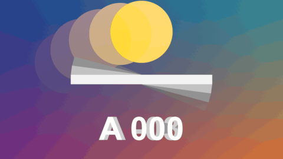

# Echo

特效 · 檔案 `templates/Effects/Echo.setting` · [回到總覽](../../README.md)

會動的東西後面拖著幾個逐漸變淡的殘影。殘影是片段前幾格的畫面疊在現在的畫面上。

**用法**：拖到片段上。

| 參數 | 作用 |
|---|---|
| `Echoes` | 幾個殘影，1 到 8 |
| `Frames Apart` | 每個殘影相隔幾格 |
| `Echoes Show Where They Are` | 殘影怎麼疊：`Brighter` 只在比較亮的地方出現（亮的東西在暗背景上）、`Darker` 只在比較暗的地方出現、`Anywhere` 單純半透明混合、`Added On Top` 加亮 |
| `Strength` | 第一個殘影的濃度 |
| `Each Echo Weaker By` | 每個殘影比前一個淡多少 |
| `Echoes Lead Instead Of Trail` | 殘影改成出現在動作前面（用的是之後的畫格） |

**注意**

- 靜止的部分看不出差別，只有在動的東西會有殘影。
- 片段開頭的幾格，殘影用的是修剪範圍之前的畫面；如果片段是從來源影片的第一格開始，開頭幾格就沒有殘影。
- 每個殘影都要多讀一次畫面，`Echoes` 開到 8 時播放會變慢。
