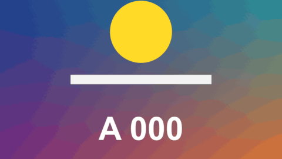

# Freeze Frame

特效 · 檔案 `templates/Effects/Freeze Frame.setting` · [回到總覽](../../README.md)

畫面在指定的時間點停住，閃一下、推近、變色，像電影停下來介紹角色。名字用 [Text Label](text-label.md) 疊在上方的軌道。

**用法**：拖到片段上，在 `Freezes` 裡寫停格的時間和長度。

| 參數 | 作用 |
|---|---|
| `Freezes` | 停格清單，一行一次：時間，空格，停幾秒。例如 `0:02 1.5` 是第 2 秒停 1.5 秒 |
| `After A Freeze` | 停格結束後怎麼接，見下方 |
| `Frame Rate Override` | 時間點不對時，填上片段的影格率。0 是自動 |
| `Colour` | 停格時的顏色：`Unchanged` 不變、`Black And White` 黑白、`Tinted` 單色、`High Contrast` 高反差的兩色版畫 |
| `Tint Colour` | `Tinted` 和 `High Contrast` 用的顏色 |
| `Push In`、`Push In Towards` | 停格時推近多少、往哪一點推 |
| `Flash` | 停住那一刻閃白的程度 |
| `Dark Corners` | 停格時四角變暗的程度 |
| `Settle Time` | 推近和變色花幾秒到位 |
| `While Frozen: Keep Pushing In` | 停住的期間畫面繼續慢慢推近，每秒多推多少。0 是到位後就完全不動 |
| `While Frozen: Tilt` | 停住的期間畫面慢慢傾斜，每秒轉幾度。正負決定方向，0 是不轉。傾斜時會自動多放大一點，四個角不會露出空白 |
| `Spring Back Time` | 停格結束後，畫面花幾秒彈回正常的大小、角度和顏色。這段時間影片已經在繼續播了，一開始很快、最後輕輕停住。0 是直接切回去 |

時間點可以寫成 `1:25`、`120f`、`25%` 三種，從片段開頭算起，詳見[時間清單的寫法](../time-list.md)。

**注意**

- **停格會佔掉時間**，兩種接法各有代價。`Jump Ahead` 是停格結束後直接跳到當下的時間，畫面和聲音保持同步，但停格期間的畫面就看不到了。`Carry On From The Frozen Frame` 是從停住的那一格接著播，畫面不會少，但之後的畫面會比聲音晚，片段結尾也會少掉停格的長度。
- 用第二種接法時，建議把這個片段的聲音分離出來另外處理。
- 沒有停格的時候畫面完全不變。
