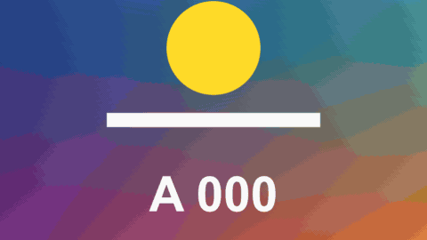

# Glitch Cut

轉場 · 檔案 `templates/Transitions/Glitch Cut.setting` · [回到總覽](../../README.md)

畫面像訊號不良一樣碎掉，恢復時已經是下一段。一條條橫帶左右錯位，並且一帶一帶地閃成後一段的畫面。

**用法**：拖到兩個片段的交界，拉成想要的長度。短一點比較有力，6 到 12 格左右。

| 參數 | 作用 |
|---|---|
| `Strength` | 整體強度 |
| `Sideways Jump` | 橫帶左右錯開的距離 |
| `RGB Split` | 紅綠藍錯開的程度 |
| `Bands` | 畫面分成幾條橫帶 |
| `Misplaced Blocks` | 顯示成畫面其他位置的方塊有多少 |
| `Scan Lines` | 掃描線的深淺 |
| `Frames Per Change` | 每隔幾格換一組圖樣，數字越小閃得越快 |
| `Pattern` | 換一組亂數 |

**注意**

- 中間最強，兩端是 0，開頭和結尾那一格和原片段完全相同。
- 片段的影格率比時間軸高時（例如 48fps 的素材放在 24fps 的時間軸），`Frames Per Change` 是以素材的影格計算，要調大才會一樣快。
