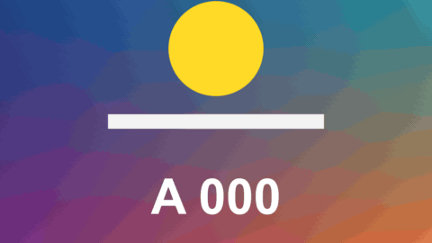

# Glitch Hits

特效 · 檔案 `templates/Effects/Glitch Hits.setting` · [回到總覽](../../README.md)

在指定的時間點，畫面像訊號不良一樣碎掉一下：橫帶錯位、方塊亂跳、紅綠藍分離、掃描線。也可以加上隨機出現的短暫故障。

**用法**：拖到片段上，在 `Hits` 裡列出時間點。

| 參數 | 作用 |
|---|---|
| `Hits` | 時間點清單，一行一下。後面可以加一個數字調整那一下的強度，例如 `0:02.5 1.5` |
| `Hit Length` | 每一下持續幾秒，強度在這段時間內降到 0 |
| `Random Bursts Per 10 Seconds` | 另外每 10 秒隨機出現幾次短暫故障，0 是關閉 |
| `Frame Rate Override` | 時間點不對時，填上片段的影格率。0 是自動 |
| `Strength` | 整體強度 |
| `Sideways Jump` | 橫帶左右錯開的距離 |
| `RGB Split` | 紅綠藍錯開的程度 |
| `Bands` | 畫面分成幾條橫帶 |
| `Misplaced Blocks` | 顯示成畫面其他位置的方塊有多少 |
| `Scan Lines` | 掃描線的深淺 |
| `Frames Per Change` | 每隔幾格換一組圖樣 |
| `Pattern` | 換一組亂數 |

時間點可以寫成 `1:25`、`120f`、`25%` 三種，從片段開頭算起，詳見[時間清單的寫法](../time-list.md)。

**注意**

- 沒有故障的時候畫面完全不變。
- 想讓整段一直輕微故障，把 `Hits` 清空、`Random Bursts Per 10 Seconds` 調到 20 以上。
