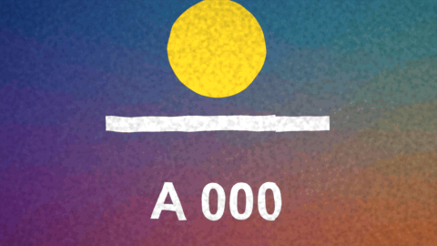

# Handmade

特效 · 檔案 `templates/Effects/Handmade.setting` · [回到總覽](../../README.md)

讓片段看起來像手工做的動畫：動作一格一格跳，每一格擺的位置都差一點，輪廓會抖，再蓋上紙的紋理。

**用法**：拖到片段上。

| 參數 | 作用 |
|---|---|
| `Frames Per Step` | 每幾格才換一次畫面，數字越大越卡 |
| `Jitter` | 每換一次畫面，位置隨機偏移的幅度 |
| `Jitter Rotation` | 每換一次畫面，隨機轉動的角度 |
| `Wobbly Outlines` | 輪廓扭曲的幅度，0 是關閉 |
| `Wobble Size` | 扭曲的粗細，數字越大越細碎 |
| `Colour Steps` | 把顏色壓成幾階，0 是關閉。4 到 6 像剪紙或版畫 |
| `Paper Grain` | 紙張紋理的深淺 |
| `Light Flicker` | 每換一次畫面，亮度隨機變化的幅度 |
| `Dark Corners` | 四角變暗的程度 |

**注意**

- 畫面會稍微放大，避免抖動時露出邊緣。
- 片段的影格率比時間軸高時，`Frames Per Step` 是以素材的影格計算，要調大才會一樣卡。
