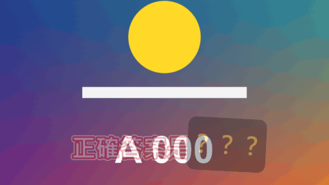

# Hidden Word

標題 · 檔案 `templates/Titles/Hidden Word.setting` · [回到總覽](../../README.md)

字幕裡有一個詞先被貼紙蓋住，到了揭曉的時間貼紙掉下來，那個詞換一個顏色彈出來。猜謎節目賣關子的手法。

**用法**：拖到影片上方的軌道，拉成想要的長度。背景是透明的。把要藏起來的詞用星號包住，例如 `正確答案是*香蕉*`。

| 參數 | 作用 |
|---|---|
| `Text` | 字幕內容，用 `*星號*` 標出要藏的詞（一句一個） |
| `Reveal After` | 片段開始後多久揭曉。可以寫秒數 `2`、分秒 `0:02.5`、格數 `48f`、比例 `40%` |
| `Frame Rate Override` | 時間點不對時，填上片段的影格率。0 是自動 |
| `Sticker Text` | 貼紙上的字，預設是 `？？？` |
| `Sticker Leaves By` | 貼紙怎麼離開：`Flipping Over` 翻面、`Flying Up` 往上飛走、`Bursting` 放大消失、`Sliding Off To The Right` 往右滑走 |
| `Reveal Frames` | 揭曉的動作花幾格 |
| `Font` | 字型和字重 |
| `Size`、`Position` | 大小和位置 |
| `Hidden Word Size` | 被藏的詞比其他字大幾倍 |
| `Hidden Word Gap` | 被藏的詞左右留多少空隙 |
| `Sticker Padding`、`Sticker Roundness`、`Sticker Tilt` | 貼紙比字大多少、圓角程度、傾斜角度 |
| `Outline`、`Outer Outline` | 內外兩層描邊的粗細 |
| `Entrance Frames`、`Fade Out Frames` | 整句淡入和片段結尾淡出各花幾格 |
| `Colour`、`Hidden Word Colour` | 一般的字和被藏的詞的顏色 |
| `Outline Colour`、`Outer Outline Colour` | 描邊的顏色 |
| `Sticker Colour`、`Sticker Text Colour` | 貼紙和貼紙上的字的顏色 |

**注意**

- 貼紙至少和它自己的字一樣寬，所以被藏的詞很短時，貼紙會稍微蓋到旁邊的字。把 `Sticker Text` 改短（例如一個 `？`）就不會。
- 沒有用星號標任何詞時，就是一句普通的字幕，沒有貼紙。
- 一個片段只有一句。要連續出好幾題，就一題放一個片段。
