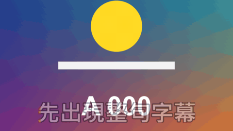

# Karaoke Caption

標題 · 檔案 `templates/Titles/Karaoke Caption.setting` · [回到總覽](../../README.md)

畫面上的那句字幕從左到右填上另一個顏色，跟著講話的速度走，像卡拉 OK 的歌詞。

**用法**：拖到影片上方的軌道，拉成想要的長度。背景是透明的。在 `Lines` 裡一行寫一句，前面加時間。

| 參數 | 作用 |
|---|---|
| `Lines` | 字幕清單，一行一句，前面是這一句出現的時間，例如 `0:02 今天要挑戰` |
| `Lines Start With A Time` | 取消勾選後清單不用寫時間，改成在 `Line Number` 打關鍵幀換句 |
| `Line Number` | 不寫時間時用：打關鍵幀 1、2、3 決定現在顯示第幾句 |
| `Frame Rate Override` | 時間點不對時，填上片段的影格率。0 是自動 |
| `Characters Per Second` | 每秒填幾個字。0 是自動：配合這一句的時間長度 |
| `Fill Is Done At` | 自動模式下，填色在這一句時間的幾成處完成。0.85 是留 15% 的時間停在填滿的狀態 |
| `Fill One Character At A Time` | 勾選後一個字一個字跳，不勾是平滑地掃過去 |
| `Font` | 字型和字重 |
| `Size`、`Position` | 大小和位置 |
| `Outline`、`Outer Outline` | 內外兩層描邊的粗細，0 是不要那一層 |
| `Pop Frames`、`Fade Out Frames` | 每句出現時彈一下、換句前淡出，各花幾格 |
| `Colour`、`Fill Colour` | 還沒填和已經填的字的顏色 |
| `Outline Colour`、`Outline Colour Of The Filled Part`、`Outer Outline Colour` | 描邊的顏色 |

時間點可以寫成 `1:25`、`120f`、`25%` 三種，從片段開頭算起，詳見[時間清單的寫法](../time-list.md)。

**注意**

- 範本不會聽聲音。填色的速度是平均分配的，講話忽快忽慢時對不準；要對得準，就把一句拆成幾行，各自寫時間。
- 一句只能有一行，太長會超出畫面，要自己斷句。
- 一個字一個字跳是用字數平均分寬度，中文很準，英文因為每個字母寬度不同會有一點偏差。
- 用關鍵幀換句時，一句最長只能往後看 60 格來判斷這一句有多長，句子比較長時改用 `Characters Per Second` 指定速度。
