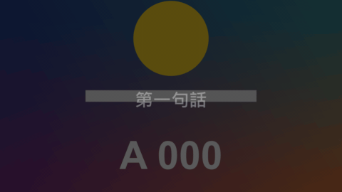

# Kinetic Lines

標題 · 檔案 `templates/Titles/Kinetic Lines.setting` · [回到總覽](../../README.md)

一行行文字照寫好的時間彈出來，後一行取代前一行。適合金句、歌詞、重點條列。



左邊是預設的樣子，後一行取代前一行。右邊是 `Earlier Lines` 選 `Stay On Screen (A List)`，變成逐條出現的條列：前面幾條留著變淡，目前這條亮著。

**用法**：拖到影片上方的軌道，拉成想要的長度。背景是透明的。

| 參數 | 作用 |
|---|---|
| `Lines` | 文字清單，一行一句，寫法見下方 |
| `Lines Start With A Time` | 預設勾選，每行開頭要寫時間。取消勾選就改用 `Line Number` 的關鍵幀來換句，每行只寫文字 |
| `Line Number` | 取消勾選上一項之後才有作用：現在顯示第幾行，打關鍵幀來換句，0 是不顯示 |
| `Frame Rate Override` | 出現的時間點不對時，填上時間軸的影格率。0 是自動 |
| `Earlier Lines` | `Are Replaced`：後一行取代前一行。`Stay On Screen (A List)`：前面的行留在畫面上，排成一份清單 |
| `Earlier Lines Brightness` | 條列模式裡，前面幾行的濃度。1 是和目前這行一樣亮 |
| `Alignment` | 對齊：`Centre` 置中、`Left` 靠左（文字從 `Position` 往右排）、`Right` 靠右 |
| `Position` | 位置 |
| `Pop Frames` | 彈出來花幾格 |
| `Fade Out Frames` | 下一行出現前，花幾格淡出。0 是直接換 |
| `Bounce` | 彈過頭再回來的幅度，0 是不彈 |
| `Grow From` | 從多大開始長。1 是不縮放 |
| `Rise` | 從下方多遠升上來，負數是從上方落下 |
| `Tilt` | 傾斜角度，單數行和雙數行往相反方向歪 |
| `Font` 到 `Box Roundness` | 字的外觀：字型、字級、字距、顏色、兩層描邊、陰影、底框。每個文字類標題都是同一組，見[文字外觀](../text-style.md) |

每行開頭寫時間，後面寫文字，時間可以寫成 `1:25`、`120f`、`25%` 三種，詳見[時間清單的寫法](../time-list.md)：

```
0:00 第一句
0:02.5 第二句
0:05 這一句|分成兩行
0:08
```

不想寫時間的話，取消勾選 `Lines Start With A Time`，清單裡每行只寫文字，然後在要換句的地方把 `Line Number` 依序打成 1、2、3 的關鍵幀。做法和注意事項見 [Variety Caption](variety-caption.md)。

**注意**

- 文字裡的 `|` 會換行。
- 條列模式裡，每一行從一開始就佔好自己的位置，所以清單不會隨著行數增加而移動。這個模式不放大縮小也不傾斜（`Grow From`、`Bounce`、`Tilt` 沒有作用），`Rise` 仍然有效；底框包住整份清單，跟著第一行一起出現。要項目符號就自己寫在每行文字的開頭。
- 條列模式只在實驗用的合成裡用腳本測過。
- 只寫時間、後面不寫字的那一行，會讓畫面從那個時間點起清空。
- 第一行的時間之前不顯示任何東西。
- 條列模式裡，前面變淡的那幾行也有同樣的描邊和陰影。
- 預設沒有描邊（`Outline` 是 0）。
- 預設字型是微軟正黑體粗體。換字型時要選有中文字的，不然中文會變成方塊。
