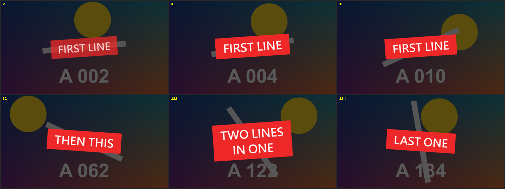

# Kinetic Lines

標題 · 檔案 `templates/Titles/Kinetic Lines.setting` · [回到總覽](../../README.md)

一行行文字照寫好的時間彈出來，後一行取代前一行。適合金句、歌詞、重點條列。



**用法**：拖到影片上方的軌道，拉成想要的長度。背景是透明的。

| 參數 | 作用 |
|---|---|
| `Lines` | 文字清單，一行一句，寫法見下方 |
| `Frame Rate Override` | 出現的時間點不對時，填上時間軸的影格率。0 是自動 |
| `Font`、`Size`、`Color`、`Position` | 字型、大小、顏色、位置 |
| `Pop Frames` | 彈出來花幾格 |
| `Fade Out Frames` | 下一行出現前，花幾格淡出。0 是直接換 |
| `Bounce` | 彈過頭再回來的幅度，0 是不彈 |
| `Grow From` | 從多大開始長。1 是不縮放 |
| `Rise` | 從下方多遠升上來，負數是從上方落下 |
| `Tilt` | 傾斜角度，單數行和雙數行往相反方向歪 |
| `Box Opacity`、`Box Color` | 文字底框的不透明度與顏色，0 是沒有底框 |
| `Box Padding X`、`Box Padding Y` | 底框在文字四周的留白 |

每行開頭寫時間，後面寫文字，時間可以寫成 `1:25`、`120f`、`25%` 三種，詳見[時間清單的寫法](../time-list.md)：

```
0:00 第一句
0:02.5 第二句
0:05 這一句|分成兩行
0:08
```

**注意**

- 文字裡的 `|` 會換行。
- 只寫時間、後面不寫字的那一行，會讓畫面從那個時間點起清空。
- 第一行的時間之前不顯示任何東西。
- 預設字型是微軟正黑體。換字型時要選有中文字的，不然中文會變成方塊。
