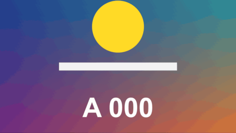

# Letterbox

標題 · 檔案 `templates/Titles/Letterbox.setting` · [回到總覽](../../README.md)

電影黑邊。開頭從上下滑進來，結尾滑出去。選的比例比畫面還窄時（例如 4:3、1:1、9:16），黑邊會改從左右進來。

**用法**：拖到最上面的軌道，拉長蓋住要有黑邊的範圍。底下不管有幾個片段都會被蓋到。

| 參數 | 作用 |
|---|---|
| `Shape` | 中間留下來的畫面比例：`2.39:1`、`2.35:1`、`2:1`、`1.85:1`、`4:3`、`1:1`、`9:16`，或 `Custom` |
| `Custom Shape (width / height)` | `Shape` 選 `Custom` 時用這個數字，寬除以高 |
| `Move The Opening` | 把中間的開口往上或往下移（左右黑邊時是往左右移） |
| `Opacity` | 黑邊的不透明度 |
| `Colour` | 黑邊的顏色，預設黑色 |
| `Slide In (seconds)`、`Slide Out (seconds)` | 滑進來和滑出去各花幾秒，0 是直接出現或不離開 |
| `Frame Rate Override` | 秒數算得不對時填時間軸的影格率，平常留 0 |

**注意**

- 這只是在上面蓋兩條色塊，底下的畫面沒有被縮放或移動。主體被黑邊切到時，要到片段本身去調位置。
- 整支片都要黑邊的話，直接改時間軸的輸出遮幅會比較省事。這個範本的用途是「某一段才出現、而且要滑進滑出」。
