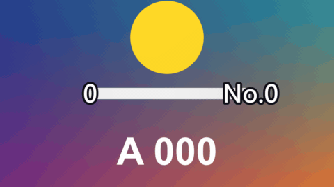

# Number Counter

標題 · 檔案 `templates/Titles/Number Counter.setting` · [回到總覽](../../README.md)

數字從一個值跳到另一個值，數完時彈一下。

**用法**：拖到影片上方的軌道，拉成想要的長度。背景是透明的。

| 參數 | 作用 |
|---|---|
| `Start Value`、`End Value` | 起始值與結束值 |
| `Decimals` | 小數位數，0 到 3 |
| `Thousands Separator` | 是否加千分位逗號 |
| `Prefix`、`Suffix` | 前後綴，例如 `$`、`%` |
| `Count Finishes At` | 在片段的哪個位置數完，之後停在結束值 |
| `Pop` | 數完時彈一下的幅度，0 是不彈 |
| `Font`、`Size`、`Color` | 字型、大小、顏色 |
| `Position` | 位置 |

**注意**

- 數字跳動時寬度會變。用每個數字等寬的字型（預設的 Open Sans 就是），文字才不會左右晃。
