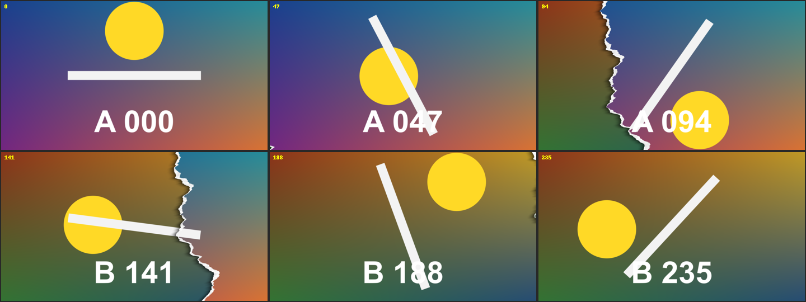

# Paper Tear

轉場 · 檔案 `templates//.setting` · [回到總覽](../../README.md)

前一段像一張紙，沿著一條不規則的線從一頭裂到另一頭，然後兩半往兩邊拉開，露出底下的後一段。撕邊看得到白色的紙芯，並在後一段上留下陰影。

**用法**：拖到兩個片段的交界，拉成想要的長度。

| 參數 | 作用 |
|---|---|
| `Angle` | 撕裂線的方向。0 是直的、由下往上裂，90 是橫的；加 180 就從另一頭開始裂 |
| `Line Position` | 撕裂線往旁邊偏多少，0 是通過畫面中央 |
| `Rip Gap` | 裂開後、拉開前，裂縫的寬度 |
| `Roughness` | 撕邊起伏的幅度，0 是直線 |
| `Tear Shape` | 換一種撕邊的形狀 |
| `Paper Edge Width` | 白色紙芯露出的寬度 |
| `Shadow`、`Shadow Width` | 陰影的濃度與寬度 |
| `Rip Time` | 裂開佔整個轉場的多少。調小是很快裂完、慢慢拉開；調大是慢慢裂、最後一下子拉開 |
| `Stop Motion Steps` | 整個過程分成幾步跳著走，0 是平滑移動 |

**注意**

- 兩段影片本身照常播放，只有撕開的動作會跟著 `Stop Motion Steps` 卡頓。
- 算圖偏慢，在 Edit 頁面不會即時播放。
