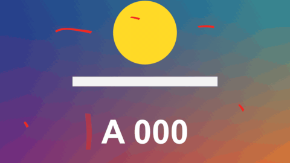

# Pen Mark

標題 · 檔案 `templates/Titles/Pen Mark.setting` · [回到總覽](../../README.md)

像用筆直接畫在畫面上的記號：把東西圈起來、畫底線、螢光筆、框起來、箭頭、打勾、打叉。線條會像手畫的一樣不穩，而且是一筆一筆畫出來的。

**用法**：拖到影片上方的軌道，拉成記號要留在畫面上的長度。在 `Shape` 選形狀，用 `Position`、`Width`、`Height` 對準要標的東西。箭頭不看這三個，改用 `Arrow: From` 和 `Arrow: To` 指定起點和終點。要同時標好幾個地方，就疊好幾條。

| 參數 | 作用 |
|---|---|
| `Shape` | `Circle` 圈、`Line` 直線（底線或刪除線）、`Wavy Line` 波浪線、`Highlighter` 螢光筆、`Box` 方框、`Corners` 只畫四個角、`Arrow` 箭頭、`Tick` 打勾、`Cross` 打叉 |
| `Position` | 記號的中心。箭頭不用這個 |
| `Width`、`Height` | 記號的寬和高，都以畫面高度為 1，所以兩個填一樣就是正圓或正方形。直線只看 `Width`；波浪線的 `Height` 是波的高度；螢光筆的 `Height` 是筆的粗細 |
| `Angle` | 旋轉角度。箭頭不用這個 |
| `Arrow: From`、`Arrow: To` | 箭頭的起點和終點 |
| `Arrow: Bend` | 箭頭彎曲的程度，0 是直的，正負決定往哪邊彎 |
| `Arrow: Head Size` | 箭頭尖端的大小，0 是沒有尖端（變成一條弧線） |
| `Thickness` | 線的粗細。螢光筆不看這個 |
| `Thin Ends` | 起筆和收筆變細的程度，0 是頭尾一樣粗 |
| `Wobble` | 手抖的程度，0 是完全工整 |
| `Wobble Seed` | 換一個數字就換一種抖法，同一個形狀疊好幾個時讓它們長得不一樣 |
| `Times Drawn Over` | 2 是同一個形狀描兩次，兩次的線不會完全重合 |
| `Redraw Every` | 每隔幾格重畫一次，線條會微微跳動，像手繪動畫。0 是畫好就不動 |
| `Circle: Overlap` | 圈的頭尾重疊多少。0 是剛好接上 |
| `Circle: Start Angle` | 圈從哪個角度起筆，順時針畫 |
| `Corners: Length` | 四個角各畫多長 |
| `Wavy Line: Waves` | 波浪線有幾個波 |
| `Opacity` | 不透明度。螢光筆建議調到 0.4 到 0.5 |
| `Outline`、`Outline Colour` | 線外面再包一圈別的顏色，背景很花的時候比較看得清楚。0 是沒有 |
| `Colour` | 線的顏色 |
| `Draw (seconds)` | 畫出來花幾秒，0 是一開始就畫好 |
| `Leaves By` | 結尾怎麼消失：`Fading` 淡出、`Being Erased` 照畫的順序擦掉、`Staying` 不消失 |
| `Leave (seconds)` | 消失花幾秒 |
| `Frame Rate Override` | 秒數算得不對時填時間軸的影格率，平常留 0 |

**注意**

- 不會自動追蹤。要跟著會動的東西，就在 `Position`（箭頭是兩個端點）打關鍵幀。
- 圈和框不會自動貼合內容，大小要自己調。
- 螢光筆是半透明疊色，做不到真的螢光筆那種「只讓底下變色、不蓋住」的效果。
- 沒有獨立的刪除線：用 `Line` 放在文字上就是了。
