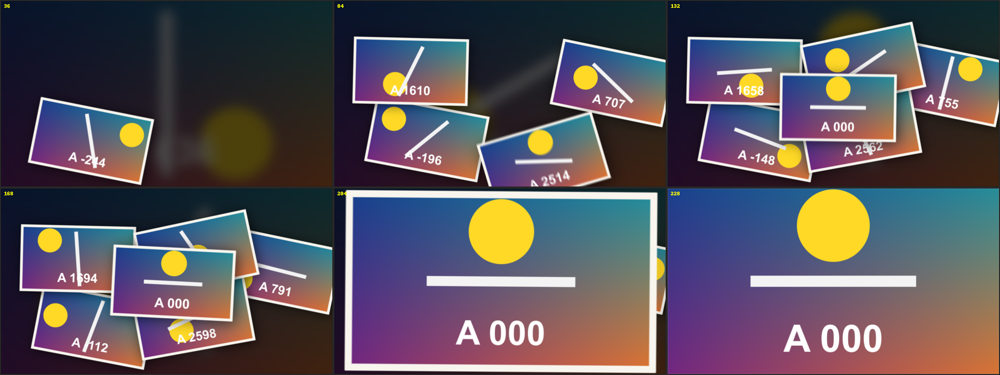

# Photo Stack

特效 · 檔案 `templates//.setting` · [回到總覽](../../README.md)

影片的幾個片刻變成照片，一張張滑到桌上，最後一張放大成全畫面。

**用法**：先把片段開頭切出想要的長度，再拖到那一段上。最後一張照片就是片段本身正在播的畫面，放大之後會無縫接回原片。

| 參數 | 作用 |
|---|---|
| `Photo Count` | 照片張數，1 到 12 |
| `Slide Time` | 每張滑進來花多久。調大，同時在空中的照片就多 |
| `Stack Complete At` | 整疊在片段的哪個位置排完，之後開始放大 |
| `Layout Seed` | 換一種排法 |
| `Photos Play As Video` | 照片播影片還是定格 |
| `Stills From`、`Stills To` | 其他照片從來源影片的哪個範圍取 |
| `Photo Size`、`Spread`、`Tilt` | 照片大小、散開程度、傾斜程度 |
| `Border`、`Corner Roundness`、`Paper Color` | 白邊的寬度、圓角、顏色 |
| `Shadow`、`Shadow Softness`、`Shadow Distance` | 陰影的濃度、柔和度、距離 |
| `Motion Blur` | 滑動時的動態模糊 |
| `Backdrop Brightness`、`Backdrop Blur` | 背景的亮度與模糊，背景是片段本身的畫面 |

**注意**

- `Stills From`、`Stills To` 是以整支來源影片的比例計，不是剪進時間軸的那一段。
- 算圖偏慢，在 Edit 頁面不會即時播放。嫌慢先關 `Motion Blur`，再不行關 `Photos Play As Video`。
