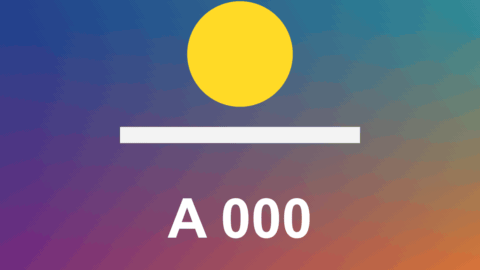

# Punch Zoom

特效 · 檔案 `templates/Effects/Punch Zoom.setting` · [回到總覽](../../README.md)

畫面在指定的時間點快速推近再彈回。每一下可以同時帶 RGB 分離、放射狀模糊、震動、扭轉、閃白，各自獨立開關。時間點可以自己列，也可以填 BPM 讓它照拍子打。



**用法**：拖到片段上，在 `Hits` 裡列出時間點，或填 `Tempo`。

| 參數 | 作用 |
|---|---|
| `Hits` | 時間點清單，一行一下，寫法見下方 |
| `Tempo` | 填 BPM 就照拍子自動打，0 是關閉。可以和 `Hits` 同時用 |
| `Every N Beats` | 每幾拍打一下 |
| `First Beat At` | 第一拍在片段開頭後幾秒 |
| `Frame Rate Override` | 時間點不對時，填上片段的影格率。0 是自動 |
| `Zoom`、`Zoom Center` | 推多近、往畫面上哪一點推 |
| `Punch In`、`Spring Back` | 推進去和彈回來各花幾秒 |
| `Stay Zoomed Until Next Hit` | 推近後停住，下一下才退回去 |
| `RGB Split` | 推的瞬間紅綠藍往外錯開的程度，0 是關閉 |
| `Zoom Blur` | 推的瞬間放射狀模糊的程度，0 是關閉 |
| `Shake` | 推的瞬間畫面亂晃的幅度，0 是關閉 |
| `Twist` | 推的瞬間畫面轉幾度，0 是關閉 |
| `Flash` | 推的瞬間變亮的程度，0 是關閉 |

時間點可以寫成 `1:25`、`120f`、`25%` 三種，從片段開頭算起，詳見[時間清單的寫法](../time-list.md)。後面可以再加一個數字，單獨調整那一下的力道：

```
0:01.2
0:03 1.5
0:04.5 0.6
```

**注意**

- 開了 `Stay Zoomed Until Next Hit` 之後，第一下推近、第二下退回、第三下再推近，依此類推，所以時間點要成對地寫。寫成單數個，最後會一直停在近景。
- 這個模式下 `Zoom` 通常要調大（0.3 左右），並把 `Zoom Center` 移到想留在畫面裡的東西上。時間後面的力道數字只對推近那一下有用。
- RGB 分離、模糊、震動、閃白在推近和退回時各出現一下，不會在停住期間持續。
- `Stay Zoomed Until Next Hit` 不建議和 `Tempo` 一起開，不然每一拍都會切換一次遠近。
- 推近就是把畫面裁切放大，`Zoom` 調太大會糊。
- 時間是從片段在時間軸上的開頭算起，修剪片段開頭之後要重填。
