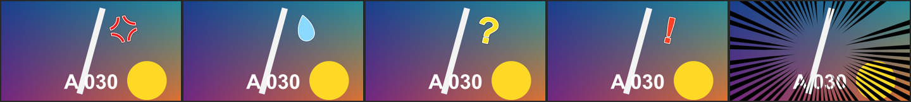

# Reaction Mark

標題 · 檔案 `templates/Titles/Reaction Mark.setting` · [回到總覽](../../README.md)

綜藝節目貼在人臉旁邊的效果符號：怒氣記號、汗滴、問號、驚嘆號，以及圍繞一個點的集中線。全部由範本畫出來，不需要圖檔。

**用法**：拖到影片上方的軌道，拉成符號要出現的長度。在 `Mark` 選符號，把 `Position` 移到人臉旁邊。集中線則是把 `Position` 放在要強調的東西上。

| 參數 | 作用 |
|---|---|
| `Mark` | 符號：`Anger` 怒氣、`Sweat Drop` 汗滴、`Question` 問號、`Exclamation` 驚嘆號、`Focus Lines` 集中線 |
| `Position` | 位置。集中線是線條指向的中心 |
| `Size` | 大小 |
| `Angle` | 傾斜角度（集中線不適用） |
| `Pop Frames` | 彈出來花幾格 |
| `Throb` | 彈出來之後持續一脹一縮的幅度，0 是不動 |
| `Fade Out Frames` | 片段結尾花幾格淡出 |
| `Outline`、`Outer Outline` | 白色內描邊、深色外描邊的粗細（集中線沒有描邊） |
| `Use My Colours` | 勾選後改用下面兩個顏色，不用符號預設的配色 |
| `My Color`、`My Outline Color` | 自訂的符號顏色和內描邊顏色 |
| `Focus Lines: Count` | 集中線的數量 |
| `Focus Lines: Clear Area` | 中心留空的範圍，以 `Size` 為單位 |
| `Focus Lines: Thickness` | 線條的粗細 |
| `Focus Lines: Frames Per Change` | 每隔幾格換一組線條，數字越小閃得越快 |

**注意**

- `Position` 可以打關鍵幀，讓符號跟著人移動。
- 集中線預設是黑色。要白色就勾 `Use My Colours`，把 `My Color` 改成白色。
- 一個片段只有一個符號。要同時出現好幾個，就在不同軌道各放一個。
