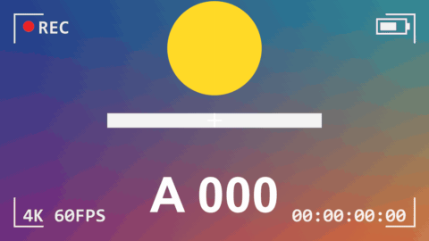

# Rec Frame

標題 · 檔案 `templates/Titles/Rec Frame.setting` · [回到總覽](../../README.md)

攝影機觀景窗的畫面：四個角的框線、閃爍的 REC 紅點、會跑的時間碼、電池、一行文字、中央十字、三分線。每一項都可以關掉。

**用法**：拖到影片上方的軌道，拉成要顯示的長度。時間碼從標題的開頭起算。

| 參數 | 作用 |
|---|---|
| `Distance From The Edge` | 四角框線離畫面邊緣多遠。其他東西都排在框線裡面 |
| `Line Thickness` | 線條粗細 |
| `Corner Marks: Length` | 四角框線的長度，0 是不畫 |
| `REC Dot` | 左上角的紅點 |
| `REC Dot: Seconds Per Blink` | 幾秒閃一次，0 是不閃 |
| `REC Text` | 紅點旁邊的字，預設 `REC`。清空就只有紅點 |
| `Timecode` | 右下角的時間碼 |
| `Timecode: Starts At (seconds)` | 時間碼從幾秒開始。3600 就是從 01:00:00:00 起跳 |
| `Text At The Bottom Left` | 左下角的字，預設 `4K 60FPS`，可以改成日期、鏡頭資訊等，清空就不顯示 |
| `Battery` | 右上角的電池 |
| `Battery: Charge` | 電量，0 到 1。可以打關鍵幀讓它慢慢掉 |
| `Centre Cross` | 畫面正中央的十字 |
| `Grid Opacity` | 三分線的濃度，0 是不畫 |
| `Text Size` | 字的大小，紅點和電池也跟著變 |
| `Opacity` | 整體不透明度 |
| `Font` | 字型，預設 `Consolas` |
| `Colour`、`REC Dot Colour` | 線和字的顏色、紅點的顏色 |
| `Frame Rate Override` | 時間碼跑得不對時填時間軸的影格率，平常留 0 |

**注意**

- 時間碼是照標題自己的長度算的，不是讀底下影片的時間碼。
- 預設字型 `Consolas` 沒有中文。左下角要寫中文的話，字型換成 `Microsoft JhengHei`，不過三處文字用的是同一個字型，會一起換。
