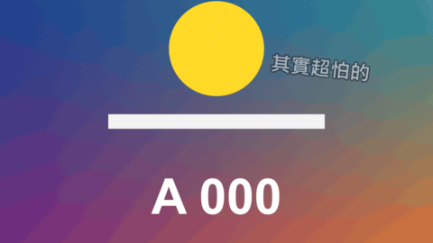

# Side Note

標題 · 檔案 `templates/Titles/Side Note.setting` · [回到總覽](../../README.md)

吐槽用的小字：歪歪的一句話，加一支手繪感的箭頭指向畫面上的某個地方。箭頭會在字彈出來之後一筆畫過去。

**用法**：拖到影片上方的軌道。把 `Text Position` 移到要放字的空位，把 `Arrow Points At` 移到要指的東西上。箭頭會自己從文字靠近目標的那一側出發。

| 參數 | 作用 |
|---|---|
| `Remarks` | 吐槽的內容，一行一句。只要一句就寫一行 |
| `Line Number` | 現在顯示第幾行。打關鍵幀來換句，0 是不顯示。用法和 [Variety Caption](variety-caption.md) 相同 |
| `Lines Start With A Time` | 勾選後改用時間清單：每行開頭寫時間，見[時間清單的寫法](../time-list.md) |
| `Frame Rate Override` | 用時間清單而且時間點不對時，填上時間軸的影格率。0 是自動 |
| `Tilt` | 傾斜角度 |
| `Text Position` | 文字的位置 |
| `Arrow Points At` | 箭頭指向的位置 |
| `Arrow` | 要不要箭頭 |
| `Arrow Bend` | 箭頭彎曲的程度，負數往另一邊彎，0 是直線 |
| `Arrow Thickness`、`Arrow Head` | 箭頭線條的粗細、箭頭尖端的大小 |
| `Arrow Stops Short` | 箭頭在離目標多遠的地方停下，免得蓋住要指的東西 |
| `Pop Frames` | 字彈出來花幾格 |
| `Arrow Draw Frames` | 箭頭畫完花幾格 |
| `Fade Out Frames` | 換下一句之前花幾格淡出 |
| `Font` 到 `Shadow Softness` | 字的外觀：字型、字級、字距、顏色、兩層描邊、陰影。每個文字類標題都是同一組，見[文字外觀](../text-style.md) |

箭頭和字用同一組外觀：一樣的顏色、描邊和陰影。

**注意**

- `Text Position` 和 `Arrow Points At` 都可以打關鍵幀，讓箭頭跟著移動的東西走。
- 文字裡的 `|` 會換行。
- 文字和目標靠得太近時箭頭會很短，把文字移遠一點。
- 預設字型是微軟正黑體粗體。換字型時要選有中文字的。
