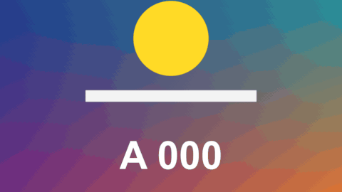

# Spotlight

特效 · 檔案 `templates/Effects/Spotlight.setting` · [回到總覽](../../README.md)

畫面上只有一塊保持原樣，其他地方變暗（也可以變模糊、變灰），讓觀眾看那一塊。那一塊還可以當放大鏡用。適合教學和指出細節。

**用法**：拖到片段上，把 `Position` 移到要強調的地方。只想強調一小段時間，就先把那一段切出來再套。

| 參數 | 作用 |
|---|---|
| `Position` | 亮區的中心 |
| `Size` | 亮區的高度，以畫面高度為 1 |
| `Width / Height` | 寬高比，1 是圓形或正方形 |
| `Corner Roundness` | 1 是圓形或膠囊形，0 是矩形 |
| `Edge Softness` | 亮區邊緣的柔和度 |
| `Outside: Darken` | 亮區以外變暗的程度 |
| `Outside: Blur` | 亮區以外的模糊程度，0 是關閉 |
| `Outside: Remove Colour` | 亮區以外褪色的程度，1 是全灰 |
| `Magnify` | 亮區裡面放大幾倍，1 是不放大 |
| `Ring Width`、`Ring Colour` | 亮區邊緣的一圈線，0 是沒有 |
| `Fade In Frames`、`Fade Out Frames` | 片段開頭和結尾各花幾格漸入、漸出 |

**注意**

- `Position` 和 `Size` 可以打關鍵幀，讓亮區跟著東西移動。
- 放大時，`Edge Softness` 調小、`Ring Width` 調大一點，看起來比較像鏡片。
