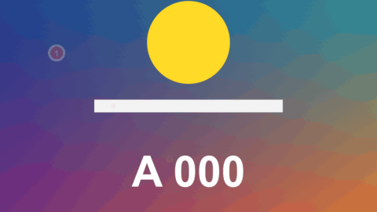

# Step Badge

標題 · 檔案 `templates/Titles/Step Badge.setting` · [回到總覽](../../README.md)

彈出來的圓形編號。旁邊可以加一行字，字會放在從徽章後面滑出來的膠囊底上。用來標教學的第幾步，或替畫面上的東西編號。

**用法**：拖到影片上方的軌道，在 `Number` 填編號，把 `Position` 移到要標的地方。一個編號一條標題，要 1、2、3 依序出現，就把三條標題的開頭錯開。

| 參數 | 作用 |
|---|---|
| `Number` | 徽章裡的字。不限數字，`A`、`B2`、`!` 都可以，超過一個字會自動縮小 |
| `Number Font` | 編號的字型 |
| `Text Beside It` | 徽章旁邊的說明文字，留空就只有徽章、沒有膠囊 |
| `Text Font` | 說明文字的字型，預設是 `Microsoft JhengHei` |
| `Position` | 徽章的中心 |
| `Size` | 徽章的直徑，以畫面高度為 1 |
| `Shape` | `Circle` 圓形、`Rounded Square` 圓角方塊、`Square` 方塊 |
| `Border Width` | 徽章外框的粗細，0 是沒有 |
| `Text Is On The` | 說明文字在徽章的右邊還是左邊 |
| `Text Size` | 說明文字的大小 |
| `Text Distance` | 說明文字離徽章多遠 |
| `Capsule Height` | 膠囊的高度，以徽章的大小為 1。比 1 小，膠囊就比徽章矮 |
| `Capsule Opacity` | 膠囊底的不透明度，0 是只有字 |
| `Colour`、`Border Colour`、`Number Colour` | 徽章底色、外框顏色、編號顏色 |
| `Text Colour`、`Capsule Colour` | 說明文字的顏色、膠囊底的顏色 |
| `Appears By` | `Popping Up` 彈出來、`Fading In` 淡入 |
| `Appear (seconds)` | 出現花幾秒，0 是一開始就在。徽章到位之後，膠囊才帶著文字滑出來 |
| `Fade Out (seconds)` | 結尾淡出花幾秒 |
| `Frame Rate Override` | 秒數算得不對時填時間軸的影格率，平常留 0 |

**注意**

- 說明文字只有一行，膠囊的長度會自動貼合文字。要多行就用 [Text Label](text-label.md) 另外疊一個。
- 膠囊的兩端一定是圓的，不會跟著 `Shape` 變成方的。
