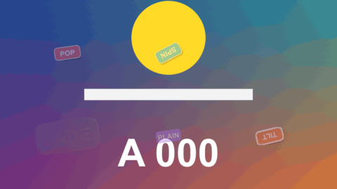

# Sticker Pop

特效 · 檔案 `templates/Effects/Sticker Pop.setting` · [回到總覽](../../README.md)

去背的圖片（PNG、logo、迷因圖、表情符號）彈進來，停留的時候輕輕晃動，結尾再彈走。可以沿著圖片的形狀加一圈貼紙白邊和陰影。圖片透明的地方保持透明。

圖上六張各是一種設定：`Pop` 加搖、`Spin In` 加脹縮、`Drop In` 加飄、`Fade` 加抖動、沒有白邊和陰影、歪一個角度加粗白邊。

**用法**：把圖片放在影片上方的軌道，拉成要顯示的長度，再把這個特效拖到圖片上。位置和整體大小用片段自己的 `Transform`（Inspector 的 Video 頁）調。

| 參數 | 作用 |
|---|---|
| `Size` | 圖片在自己的畫框裡縮成多大。預設 0.7，留一點空間給彈過頭的那一下、白邊和陰影 |
| `Tilt (degrees)` | 歪幾度 |
| `Mirror` | 左右鏡像 |
| `Entrance` | 進場方式：`Pop` 彈出、`Spin In` 邊轉邊彈出、`Drop In` 從上面掉下來彈兩下、`Fade` 淡入、`None` 直接出現 |
| `Entrance Frames`、`Exit Frames` | 進場和退場各花幾格。退場是縮小消失，`Fade` 是淡出，`None` 沒有退場 |
| `Bounce` | 彈過頭的幅度，0 是不彈 |
| `While It Stays` | 停留時的動作：`Still` 不動、`Wobble` 左右搖、`Float` 上下飄、`Pulse` 一脹一縮、`Shake` 抖動 |
| `Movement Amount` | 動作的幅度 |
| `Movements Per Second` | 每秒搖（飄、脹縮）幾次。對 `Shake` 沒有作用 |
| `Outline Width`、`Outline Colour` | 沿著圖片形狀的外框，像貼紙的白邊。0 是沒有 |
| `Shadow`、`Shadow Distance`、`Shadow Softness` | 陰影的濃度、距離、柔和度 |
| `Frame Rate Override` | 搖晃的速度不對時填時間軸的影格率，平常留 0 |

**注意**

- 這個特效只在實驗用的合成裡用腳本測過，用的是程序畫出來的去背圖，還沒有在 Edit 頁面實際套在 PNG 上。
- 特效只能畫在圖片自己的畫框裡，超出去的部分會被切掉。`Size` 調到接近 1、或圖片本來就貼著邊時，彈過頭的那一下、白邊和陰影可能被切到，把 `Size` 調小，再用片段的 `Transform` 放大回來。`Drop In` 是從畫框上緣掉進來的，所以圖片會從自己畫框的上緣出現，不是從整個畫面的上緣。
- 沒有去背的圖片或影片也能套，白邊會沿著整個畫框的四邊。
- 要在同一個位置依序出現好幾張圖，一張圖一個片段，各套一次。
