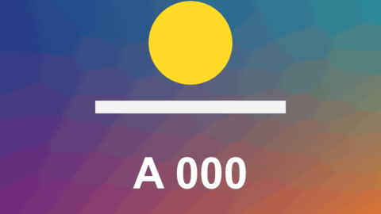

# Stripe Wipe

轉場 · 檔案 `templates/Transitions/Stripe Wipe.setting` · [回到總覽](../../README.md)

幾條純色的色帶依序掃過畫面，掃過之後就是下一段。綜藝節目換話題時常見的手法。可以把畫面分成幾列，每列晚一點出發。

**用法**：拖到兩個片段的交界，拉成想要的長度。

| 參數 | 作用 |
|---|---|
| `Bars Move` | 色帶往哪邊掃：`Right`、`Left`、`Up`、`Down` |
| `Slant` | 色帶傾斜幾度 |
| `Bars` | 幾條色帶，1 到 5 |
| `Bar Width` | 每條的寬度，以畫面為 1 |
| `Rows` | 把畫面分成幾列，1 是不分 |
| `Row Delay` | 分列時，最後一列比第一列晚多少出發 |
| `Rows Alternate Direction` | 分列時，相鄰兩列往相反方向掃 |
| `Ease` | 起步和煞車有多急，1 是等速 |
| `Colours` | 配色：`Variety`、`Candy`、`News`、`Neon`、`Mono`，或 `Custom` 用下面五個顏色 |
| `Custom Colour 1` 到 `Custom Colour 5` | `Colours` 選 `Custom` 時用的顏色，依色帶出現的順序 |

**注意**

- 分列加上 `Slant` 會讓每列的斜邊對不齊，分列時建議把 `Slant` 設成 0。
- 開頭和結尾那一格和原片段完全相同。
