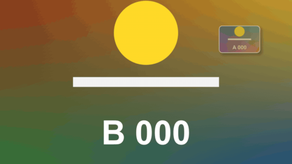
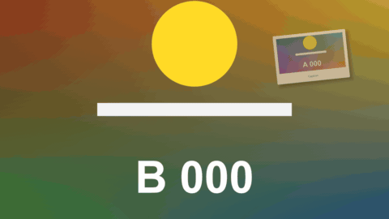

# Sub Window

特效 · 檔案 `templates/Effects/Sub Window.setting` · [回到總覽](../../README.md)

把片段縮成一個帶外框和陰影的小窗，會彈進來，可以放在角落當反應畫面，也可以放大當相片、截圖、手機畫面來展示。小窗以外是透明的。外框有七種樣式：一般邊框、拍立得、應用程式視窗、手機、膠帶貼著的照片、底片、雙線。

小窗可以在結尾放大成全畫面（或一開始是全畫面，再縮進小窗）：

**用法**：把要當子畫面的片段放在主畫面**上方的軌道**，再把這個特效拖到它上面。剛套上去時小窗在畫面正中央、高度是畫面的一半，用 `Position` 和 `Size` 把它移到角落、縮成想要的大小。

| 參數 | 作用 |
|---|---|
| `Frame Style` | 外框樣式，見下表 |
| `Shape` | 形狀：`Circle` 圓形、`Rounded` 圓角矩形、`Rectangle` 矩形。只對 `Plain`、`Taped Photo`、`Double Line` 有作用，其他樣式有自己的形狀 |
| `Position` | 小窗的中心位置 |
| `Size` | 整個小窗（含外框）的高度，以畫面高度為 1 |
| `Width / Height` | 寬高比。圓形和 `Phone` 不適用 |
| `Corner Roundness` | 圓角的程度，只對 `Shape` 選 `Rounded` 時有效 |
| `Tilt (degrees)` | 小窗歪幾度，裡面的畫面跟著歪 |
| `Border` | 邊框的粗細。有自己外框的樣式（拍立得、視窗、手機）是在原本的外框上再加這麼多；對 `Film` 沒有作用 |
| `Caption` | 一行字。`Polaroid` 寫在下方的寬邊上，`App Window` 寫在標題列。其他樣式不顯示 |
| `Zoom Into The Clip` | 放大片段幾倍再放進小窗，用來只取臉的部分 |
| `Part Of The Clip Shown` | 小窗的中心對準片段上的哪一點 |
| `Mirror` | 左右鏡像 |
| `Shadow`、`Shadow Distance`、`Shadow Softness` | 陰影的濃度、距離、柔和度 |
| `Entrance` | 進場方式：`Pop` 彈出、`Grow` 長大、`From The Nearest Edge` 從最近的畫面邊緣滑入、`Fade` 淡入、`None` |
| `Entrance Frames`、`Exit Frames` | 進場和退場各花幾格。退場用和進場相反的方式 |
| `While It Stays` | 停留時的動作：`Still` 不動、`Float` 上下飄、`Wobble` 左右搖 |
| `Movement Amount`、`Movements Per Second` | 動作的幅度，每秒幾次 |
| `Fills The Whole Frame` | `Never`：一直是小窗。`At The Start, Then Shrinks Into The Window`：一開始是全畫面，再縮進小窗。`At The End, Growing Out Of The Window`：結尾從小窗放大成全畫面 |
| `Shrink / Grow Frames` | 縮進去或放大花幾格 |
| `Border Colour` | 外框的顏色。`Phone` 和 `Film` 的外框固定是黑的 |
| `Caption Font`、`Caption Colour` | `Caption` 的字型和顏色 |
| `Frame Rate Override` | 停留動作的速度不對時填時間軸的影格率，平常留 0 |

外框樣式：

| `Frame Style` | 樣子 |
|---|---|
| `Plain` | 一圈等寬的邊框 |
| `Polaroid` | 白色相紙，下緣特別寬，可以寫 `Caption` |
| `App Window` | 上方一條標題列，左邊三個彩色圓點，旁邊可以寫 `Caption` |
| `Phone` | 黑色手機，螢幕上方有鏡頭孔。寬高比固定是直式的 |
| `Taped Photo` | 一般邊框，上緣貼一段半透明的膠帶 |
| `Film` | 上下兩條黑邊，各有一排透空的齒孔 |
| `Double Line` | 兩圈細線，中間透空 |

**注意**

- `Position`、`Part Of The Clip Shown`、`Tilt` 都可以打關鍵幀。
- 小窗顯示的範圍和畫面區域自己的寬高比相同，所以畫面不會被壓扁。
- 同一個片段既當主畫面又當子畫面時，把片段複製一份放到上方軌道再套。
- 全畫面的那一格（選 `At The Start` 時的第一格、`At The End` 時的最後一格）和原片段完全相同，可以直接接同一個片段沒套特效的部分：先在角落預告，放大之後切成主畫面。那一側沒有進場（或退場）動畫。
- `Taped Photo` 的膠帶有一半貼在小窗外面，小窗緊貼畫面上緣時膠帶會被切掉。
- 預設字型是微軟正黑體。換字型時要選有中文字的，不然中文會變成方塊。
- 這個特效主要是在實驗用的合成裡用腳本測的。片段的解析度和時間軸不同時（例如直式截圖放進橫式時間軸）會怎樣，沒有測過。
