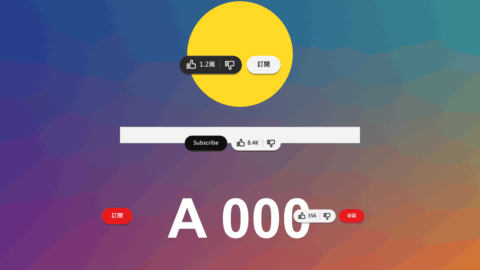

# Subscribe Reminder

標題 · 檔案 `templates/Titles/Subscribe Reminder.setting` · [回到總覽](../../README.md)

「按讚、訂閱、開啟小鈴鐺」。一排像影片網站那樣的按鈕彈出來：一顆有拇指、數字和倒讚的膠囊，旁邊是訂閱按鈕。接著依序被按三下：拇指變成實心，訂閱按鈕變灰、換字、裡面出現鈴鐺，最後鈴鐺變成實心並搖幾下。結尾縮小消失。

圖上四組各是一種設定：深色配色、亮色配色的英文版（訂閱按鈕在左邊，先訂閱再按讚）、只有一顆紅色訂閱按鈕、紅色按鈕加會跳一號的讚數。

**用法**：拖到影片上方的軌道，拉成想要的長度（四到六秒比較剛好），移動 `Position`。背景是透明的。

三次點擊的時間各自設定，所以要「按讚、訂閱、小鈴鐺」還是「訂閱、按讚、小鈴鐺」都可以，把時間排成想要的先後就好。字都可以改，中文英文都行。

| 參數 | 作用 |
|---|---|
| `Like Button` | 要不要讚的那顆膠囊 |
| `Number Of Likes` | 拇指旁邊的字，直接打你要顯示的樣子，例如 `1.2萬`、`8.4K`、`356` |
| `Number Of Likes After The Click` | 按下去之後的字。想讓數字跳一號就填新的數字；留空或填一樣的就不變 |
| `Like Is Clicked At` | 讚在片段的哪裡被按下，0 是開頭、1 是結尾 |
| `Label` | 訂閱按鈕上的字 |
| `Label After The Click` | 按下去之後的字 |
| `Subscribe Is Clicked At` | 訂閱按鈕在片段的哪裡被按下 |
| `Bell` | 要不要鈴鐺。鈴鐺在訂閱按鈕被按下之後才出現在按鈕裡面 |
| `Bell Is Clicked At` | 鈴鐺在片段的哪裡被按下。要比訂閱晚 |
| `Subscribe Button On The Left` | 勾選後訂閱按鈕排在左邊、讚排在右邊 |
| `Ring Around Each Click` | 每次按下時擴散出去的一圈白線 |
| `Position` | 整排的中心 |
| `Font` | 字型和字重 |
| `Size` | 字級，按鈕和圖示跟著等比例縮放 |
| `Shadow` | 陰影的濃度，0 是沒有 |
| `Entrance Frames`、`Leave Frames` | 彈出來和縮小消失各花幾格。`Leave Frames` 設 0 就不會消失 |
| `Colours` | 配色：`Dark` 白色訂閱按鈕加深灰膠囊、`Light` 黑色訂閱按鈕加淺灰膠囊、`Red Button` 紅色訂閱按鈕加淺灰膠囊，或 `Custom` 自己選 |
| `Custom …` 四個顏色 | `Colours` 選 `Custom` 時才有作用：訂閱按鈕、它的字、灰色膠囊（按下後的訂閱按鈕也是這個顏色）、膠囊上的字和圖示 |

**注意**

- 只在實驗用的合成裡用腳本測過，還沒有從 Edit 頁面拖進時間軸試過。
- 版面是照影片網站常見的排法畫的，圖示都是範本自己用幾何形狀拼的，沒有任何商標。
- 沒有滑鼠游標，只有按下時的那一圈線。
- 訂閱按鈕被按下後會變寬（多了鈴鐺和小箭頭）。訂閱按鈕在左邊時，右邊的讚會跟著往右跳一下。
- 圖示搖晃的快慢是照格數算的，影格率很高的時間軸上會顯得比較快。
- 算圖比一般標題慢，在 Edit 頁面可能不會即時播放。
- 預設字型是微軟正黑體粗體。換字型時要選有中文字的，不然中文會變成方塊。
