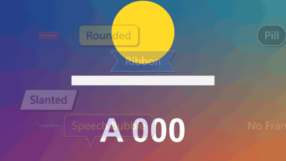
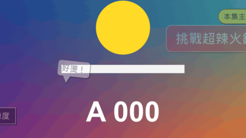

# Text Label

標題 · 檔案 `templates/Titles/Text Label.setting` · [回到總覽](../../README.md)

一段文字加一個自動貼合的外框。這是通用的積木：選外框形狀、配色、進場方式，一個片段就是一張標籤；在不同軌道疊好幾個，就能拼出角落主題框、人名條、對話泡泡、評分條這類圖卡。

九種外框，配色各不相同：

五個標籤疊在一起的例子（右上角是兩個靠右對齊的標籤，左下角是兩個靠左對齊的標籤）：

**用法**：拖到影片上方的軌道，拉成要顯示的長度，打字，移動 `Position`。要拼接就再拖一個到上面一條軌道。

| 參數 | 作用 |
|---|---|
| `Text` | 文字，可以多行 |
| `Position` | 位置 |
| `Position Is The` | `Position` 指的是外框的哪裡：`Left Edge` 左緣、`Middle` 中間、`Right Edge` 右緣。字數改變時，外框會從這個點往另一邊長 |
| `Tilt` | 傾斜角度 |
| `Frame` | 外框形狀：`Rectangle` 方框、`Rounded` 圓角、`Pill` 膠囊、`Slanted` 斜切、`Ribbon` 緞帶、`Underline` 只有底線、`Corner Marks` 只有對角的角標、`Speech Bubble` 對話泡泡、`No Frame` 沒有外框 |
| `Frame Padding X`、`Frame Padding Y` | 外框在文字四周的留白 |
| `Roundness` | 圓角的程度（`Rounded` 和 `Speech Bubble`） |
| `Slant` | 斜切的程度，負數往另一邊斜（`Slanted`） |
| `Border` | 邊線的粗細，0 是沒有邊線。`Corner Marks` 的線條粗細也是它 |
| `Frame Opacity` | 外框底色的不透明度。調低就是半透明的底 |
| `Frame Shadow X`、`Frame Shadow Y` | 外框陰影往右、往上偏移多少。都設 0 就沒有陰影 |
| `Frame Shadow Opacity` | 外框陰影的不透明度 |
| `Entrance` | 進場：`None` 直接出現、`Pop` 彈出、`From Left`／`From Right`／`From Below`／`From Above` 從某一邊滑進來、`Wipe` 從左到右揭開 |
| `Entrance Frames` | 進場花幾格 |
| `Slide Distance` | 滑進來的距離 |
| `Leave The Same Way At The End` | 勾選後，片段結尾用同樣的方式離開 |
| `Leave Frames` | 離開花幾格 |
| `Colours` | 配色：八組預設，或 `Custom` |
| `Font` 到 `Shadow Softness` | 字的外觀：字型、字級、字距、顏色、兩層描邊、陰影（這裡的陰影是字自己的，和外框陰影分開）。每個文字類標題都是同一組，見[文字外觀](../text-style.md) |
| `Custom …` 三個顏色 | `Colours` 選 `Custom` 時才有作用：外框底色、邊線、外框陰影 |

**拼接的訣竅**

- 要讓幾個標籤靠同一邊對齊，把它們的 `Position Is The` 設成同一邊，`Position` 的 X 設成一樣的數值。之後不管改成幾個字，那一邊都會對齊。
- 只有一行字的標籤，外框高度只看 `Size` 和 `Frame Padding Y`，不看是哪些字。所以大小相同的標籤高度一定一樣，可以整齊地排成一列或一疊。
- 小標籤疊在大標籤的角上：兩個片段放不同軌道，上面那條軌道的會蓋在上面。
- 讓標籤一個接一個出現：把片段的開頭錯開幾格，或是給它們不同的 `Entrance Frames`。

**注意**

- `Underline`、`No Frame` 沒有邊線，`Corner Marks`、`No Frame` 沒有底色和陰影。
- `Slanted` 只有外框是斜的，文字不會跟著斜。想要斜體字就換字型的樣式。
- 一個片段就是一張標籤，文字不會中途更換。要換字就放下一個片段，或改用 [Variety Caption](variety-caption.md)。
- `Colours` 選了預設配色時，`Colour` 和 `Outline Colour` 兩個欄位不起作用，要選 `Custom` 才看它們。
- 預設沒有文字描邊（`Outline` 是 0）。
- 預設字型是微軟正黑體粗體。換字型時要選有中文字的，不然中文會變成方塊。
