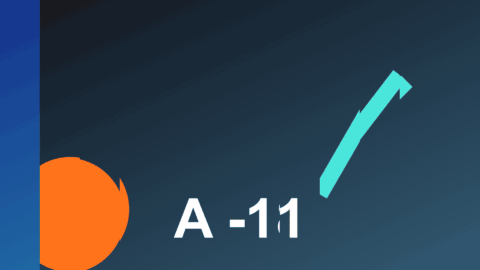

# Time Slice

特效 · 檔案 `templates/Effects/Time Slice.setting` · [回到總覽](../../README.md)

畫面切成直條，每條比隔壁晚幾格。畫面裡有東西在動時，動作會像波浪一樣掃過去。

**用法**：拖到片段上，整個片段都會套用。

| 參數 | 作用 |
|---|---|
| `Slices` | 切成幾條，2 到 16 |
| `Delay Per Slice` | 每條比前一條晚幾格 |
| `Horizontal Strips` | 改成橫條 |
| `From Center` | 中間最即時，往兩邊越來越晚 |
| `Reverse` | 延遲的方向反過來 |
| `Edge Softness` | 條與條之間的交界柔化 |

**注意**

- 畫面動得慢時效果不明顯，把 `Delay Per Slice` 調大。
