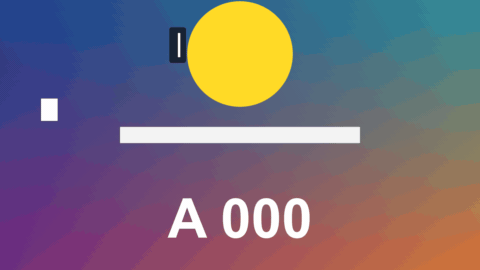

# Typing

標題 · 檔案 `templates/Titles/Typing.setting` · [回到總覽](../../README.md)

畫面上的那句字一個字一個字打出來，後面跟著游標。打完之後游標會閃，到下一句的時間就換句，也可以先倒著刪掉再換。

圖上四個各是一種設定：直線游標加底框、方塊游標加倒著刪除、底線游標從左邊開始打、沒有游標而且一直置中。

**用法**：拖到影片上方的軌道，拉成想要的長度。背景是透明的。在 `Lines` 裡一行寫一句，前面加時間。

| 參數 | 作用 |
|---|---|
| `Lines` | 清單，一行一句，前面是這一句開始打的時間，例如 `0:02 今天要挑戰` |
| `Lines Start With A Time` | 取消勾選後清單不用寫時間，改成在 `Line Number` 打關鍵幀換句 |
| `Line Number` | 不寫時間時用：打關鍵幀 1、2、3 決定現在是第幾句 |
| `Frame Rate Override` | 時間點或打字速度不對時，填上片段的影格率。0 是自動 |
| `Characters Per Second` | 每秒打幾個字。0 是自動：配合這一句的時間長度 |
| `Typing Is Done At` | 自動模式下，在這一句時間的幾成處打完。0.6 是留 40% 的時間停在打完的狀態 |
| `At The End Of A Line` | 一句結束時：`It Stays Until The Next One` 留到下一句直接換掉，`It Is Deleted Backwards` 倒著一個字一個字刪掉，剛好在下一句開始前刪完 |
| `Deleted Characters Per Second` | 倒著刪的速度 |
| `Cursor` | 游標：`Bar` 直線、`Block` 方塊、`Underline` 底線、`None` 沒有 |
| `Cursor Blinks Per Second` | 停下來時游標每秒閃幾次，0 是不閃。正在打字或刪除時游標不閃 |
| `Font` | 字型和字重 |
| `Size`、`Position` | 大小和位置 |
| `Position Is` | `Position` 指的是哪裡：`Where The Line Starts` 這一句的開頭（從這裡往右打）、`The Middle Of The Finished Line` 打完之後整句的正中央（開頭不會動）、`The Middle Of What Is Typed So Far` 目前打出來的字的正中央（每多一個字整行就往左移一點） |
| `Outline` | 描邊的粗細，0 是沒有 |
| `Box Opacity` | 底框的不透明度，0 是沒有底框。底框從句子開頭到游標，會跟著字變長 |
| `Box Padding`、`Box Roundness` | 底框的留白和圓角 |
| `Colour`、`Outline Colour`、`Box Colour` | 字和游標、描邊、底框的顏色 |

時間點可以寫成 `1:25`、`120f`、`25%` 三種，從片段開頭算起，詳見[時間清單的寫法](../time-list.md)。

**注意**

- 只在實驗用的合成裡用腳本測過，還沒有從 Edit 頁面拖進時間軸試過。
- 一句只能有一行，太長會超出畫面，要自己斷句。
- 空白也算一個字，打到空白時游標會往前走一格。
- 游標和字是同一個顏色。
- 用關鍵幀換句時，一句最長只能往後看 60 格來判斷這一句有多長，所以自動速度和倒著刪除在長句子上會不準，改用 `Characters Per Second` 指定速度，或改用寫時間的清單。
- 預設字型是微軟正黑體粗體。換字型時要選有中文字的，不然中文會變成方塊。
