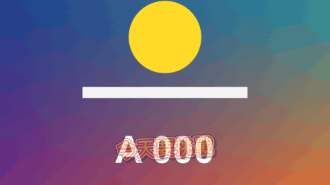

# Variety Caption

標題 · 檔案 `templates/Titles/Variety Caption.setting` · [回到總覽](../../README.md)

綜藝節目風格的字卡：三層厚描邊、漸層字，一句裡標起來的詞會放大並換顏色，進場可以彈出、砸下、抖動或滑上來。一個片段可以放很多句，用關鍵幀決定什麼時候換下一句。



**用法**：拖到影片上方的軌道，拉成想要的長度。背景是透明的。

只要一句：在 `Lines` 寫一行就好，其他不用動。

一個片段放很多句：

1. 在 `Lines` 一行寫一句。
2. 播放頭移到第一句要出現的地方，把 `Line Number` 設成 1，按它右邊的關鍵幀菱形。
3. 播放頭移到第二句要出現的地方，把 `Line Number` 改成 2（有了第一個關鍵幀之後，改數值就會自動加關鍵幀）。
4. 照這樣一路做到最後一句。之後要調時間，就拖關鍵幀。

| 參數 | 作用 |
|---|---|
| `Lines` | 字卡清單，一行一句。用 `*` 把一個詞包起來，那個詞會放大換色 |
| `Line Number` | 現在顯示第幾行。打關鍵幀來換句，0 是不顯示 |
| `Lines Start With A Time` | 勾選後改用時間清單：每行開頭寫時間，不看 `Line Number` |
| `Frame Rate Override` | 用時間清單而且時間點不對時，填上時間軸的影格率。0 是自動 |
| `Position` | 位置 |
| `Marked Word Size` | 標起來的詞放大幾倍 |
| `Marked Word Gap` | 標起來的詞和前後文字的間距 |
| `Tilt` | 傾斜角度，單數行和雙數行往相反方向歪 |
| `Sway` | 持續左右搖晃的幅度，0 是不搖 |
| `Entrance` | 進場方式：`Pop` 彈出、`Slam` 從很大砸下來再震一下、`Shake` 抖動、`Slide Up` 從下方滑上來、`None` 直接出現 |
| `Entrance Frames` | 進場花幾格 |
| `Entrance Strength` | 進場的誇張程度 |
| `Fade Out Frames` | 下一句出現前花幾格淡出。0 是直接換 |
| `Colours` | 配色：`Yellow / Red`、`White / Blue`、`White / Pink`、`Lime / Green`、`White / Black`，或 `Custom` |
| `Font` 到 `Shadow Softness` | 字的外觀：字型、字級、字距、顏色、兩層描邊、陰影。每個文字類標題都是同一組，見[文字外觀](../text-style.md) |
| `Third Outline` | 第三層描邊的粗細，包在 `Outer Outline` 外面。0 是不要那一層 |
| `Custom …` 四個顏色 | `Colours` 選 `Custom` 時才有作用：字的下緣顏色（上緣是 `Colour`，兩個之間是漸層）、標記詞的上下漸層、第三層描邊 |

`Lines` 的寫法：

```
今天要挑戰
*超級*辣的火鍋
結果*完全*不行
```

勾選 `Lines Start With A Time` 之後改成每行開頭寫時間，寫法見[時間清單的寫法](../time-list.md)：

```
0:01 今天要挑戰
0:03.5 *超級*辣的火鍋
0:07 結果*完全*不行
```

**注意**

- `Line Number` 請一次加 1。數值在兩個關鍵幀之間是慢慢變化的，範本取整數，所以會剛好在後面那個關鍵幀換句。從 1 直接跳到 3 的話，中途會閃過第 2 句；數字往回調也一樣會經過中間的句子。
- 要讓畫面暫時沒有字：在清單裡留一行空白，輪到那一行時就是空的。或是把 `Line Number` 設成 0。
- 片段開頭就要有字的話，第一個關鍵幀設 1 就好，它之前也是 1。開頭不要有字，就在片段最前面先打一個 0。
- 一行只能標一個詞。沒有標記的行可以用 `|` 換行，有標記的行只能是單行。
- 同一時間只會有一句。要兩句同時出現，就在另一條軌道再放一個。
- `Colours` 選了預設配色時，`Colour`、`Outline Colour`、`Outer Outline Colour` 三個欄位不起作用，要選 `Custom` 才看它們。
- 預設字型是微軟正黑體粗體。換成更粗的字型（例如思源黑體 Heavy）會更像綜藝字卡，但要選有中文字的字型，不然中文會變成方塊。
- 描邊很粗、字很大時算圖會變慢。
