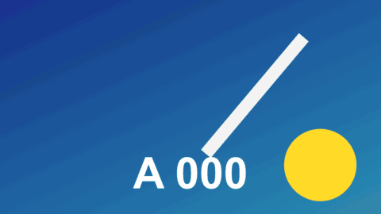

# Video Wall

轉場 · 檔案 `templates/Transitions/Video Wall.setting` · [回到總覽](../../README.md)

從前一段拉遠，發現它只是一面影片牆裡的一格；鏡頭橫移，再推進另一格變成後一段。

**用法**：拖到兩個片段的交界，拉成想要的長度。

| 參數 | 作用 |
|---|---|
| `Pull Back` | 拉多遠。1 是剛好看到整面 3×3 的牆 |
| `Gap` | 螢幕之間的間隔 |
| `Time Offset` | 其他螢幕和主畫面差幾格 |
| `Other Screens Brightness` | 其他螢幕的亮度，調低可以突顯主畫面 |

**注意**

- 牆上其他螢幕顯示的是前一段較早、後一段較晚的畫面。出現黑色螢幕時把 `Time Offset` 調成 0。
