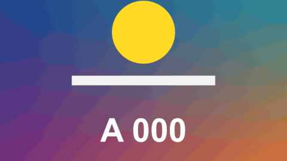

# Whip Pan

轉場 · 檔案 `templates/Transitions/Whip Pan.setting` · [回到總覽](../../README.md)

鏡頭像被用力甩開，畫面拉成一道模糊，停下來時已經是下一段。前一段滑出去，後一段緊跟在後面滑進來，兩段都沿著移動方向模糊。

**用法**：拖到兩個片段的交界，拉成想要的長度。短一點比較像甩鏡，8 到 12 格左右。

| 參數 | 作用 |
|---|---|
| `Picture Moves` | 畫面往哪邊滑：`Left`、`Right`、`Up`、`Down` |
| `Extra Angle` | 在上面的方向上再偏幾度，做出斜向的甩鏡 |
| `Blur` | 最快那一刻的模糊長度，0 是不模糊 |
| `Snap` | 起步和煞車有多急。數字越大，中間越快、兩端越慢 |
| `Screens Travelled` | 甩過幾個畫面的距離。大於 1 時中間會經過鏡像重複的畫面，看起來甩得更遠 |
| `Zoom While Moving` | 移動途中稍微放大的程度 |

**注意**

- 開頭和結尾那一格和原片段完全相同，接點不會跳。
- 模糊在畫面邊緣會拖出橫紋，速度夠快時看不出來；轉場拉得很長時可以把 `Blur` 調小。
