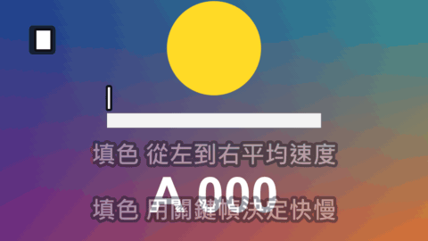

# Word By Word

標題 · 檔案 `templates/Titles/Word By Word.setting` · [回到總覽](../../README.md)

一個片段放一句話，這句話一個字一個字地進行：打出來（後面跟著游標），或整句先在畫面上、從左到右填上另一個顏色（像卡拉 OK 的歌詞）。

圖上四個各是一個片段，兩種模式各示範自動和關鍵幀兩種速度。由上到下：打字（自動平均速度，方塊游標，打完倒著刪掉）、打字（關鍵幀：打幾個字、停、再繼續）、填色（自動平均速度）、填色（關鍵幀：先慢、停一下、加速、再放慢）。

這個範本只做「句子裡面隨時間變化」的字幕。整句直接出現、照時間換句的字幕用 [Kinetic Lines](kinetic-lines.md) 或 [Variety Caption](variety-caption.md)。

**用法**：拖到影片上方的軌道，在 `Text` 填一句話。背景是透明的。**片段就是時間**：片段放在哪裡，這句話就從那裡開始；片段拉多長，打字或填色就花多久。下一句就複製這個片段、改字、調長度。

| 參數 | 作用 |
|---|---|
| `Text` | 這一句話，只能一行 |
| `The Words` | `Are Typed Out` 一個字一個字打出來、`Fill With A Second Colour` 整句先出現再從左到右填色 |
| `Done At` | 在片段的幾成處打完或填完。0.75 是留最後 25% 的時間停在完成的樣子 |
| `Fill One Character At A Time` | 填色時勾選是一個字一個字跳，不勾是平滑地掃過去 |
| `At The End Of A Typed Line` | 打字打完之後：`It Stays` 留到片段結束，`It Is Deleted Backwards` 倒著一個字一個字刪掉，片段的最後一格剛好刪完 |
| `Deleting Starts At` | 倒著刪從片段的幾成處開始。要比 `Done At` 大，不然還沒打完就開始刪 |
| `Set The Timing By Hand` | 勾選後不再平均分配速度，改看下面的 `Characters Done`。見下面「自己決定速度」 |
| `Characters Done` | 目前打到（或填到）第幾個字，在這裡打關鍵幀。只在勾選上面那一項時有作用 |
| `Cursor Of A Typed Line` | 打字時的游標：`Bar` 直線、`Block` 方塊、`Underline` 底線、`None` 沒有 |
| `Cursor Blinks Per Second` | 停下來時游標每秒閃幾次，0 是不閃。正在打字或刪除時游標不閃 |
| `Position` | 位置 |
| `Position Is` | `Position` 指的是哪裡：`Where The Line Starts` 這一句的開頭、`The Middle Of The Line` 整句的正中央、`The Middle Of What Is Typed So Far` 打字時目前打出來的字的正中央（每多一個字整行就往左移一點） |
| `Pop Frames` | 填色時，句子出現的那一下彈一下，花幾格。打字時沒有作用 |
| `Fade Out Frames` | 片段結束前花幾格淡出，0 是不淡出 |
| `Font` 到 `Box Roundness` | 字的外觀：字型、字級、字距、顏色、兩層描邊、陰影、底框。和其他文字類標題是同一組，見[文字外觀](../text-style.md) |
| `Fill Colour` | 填色時已經填的字的顏色 |
| `Outline Colour Of The Filled Part` | 填色時已經填的字的描邊顏色 |

## 自己決定速度

講話忽快忽慢、中間有停頓時，勾選 `Set The Timing By Hand`，在 `Characters Done` 打關鍵幀：

1. 播放頭移到片段開頭，`Characters Done` 填 0，打關鍵幀。
2. 移到講完某個詞的地方，填上那是第幾個字，再打一個。幾個重點位置各打一個就好，中間會自動走過去。
3. 最後一個關鍵幀填整句的字數。

關鍵幀靠得近就快，離得遠就慢。兩個關鍵幀填同一個數字是停頓；數字往回填，字就倒著消失（填色則是顏色退回去）。

- 中文一個字算一個，英文一個字母算一個，空白和標點也算。
- 填色不勾 `Fill One Character At A Time` 時，數字可以有小數，3.5 是第四個字填到一半。
- 勾選之後 `Done At`、`At The End Of A Typed Line`、`Deleting Starts At` 不起作用，要倒著刪就自己把數字打回 0。
- 游標在數字停住時閃，數字在變的時候不閃。

**注意**

- 只在實驗用的合成裡用腳本測過，還沒有從 Edit 頁面拖進時間軸試過。在檢查器裡打關鍵幀這件事也沒有實際操作過。
- 範本不會聽聲音，預設的速度是平均分配的。講話忽快忽慢時對不準；要對得準，用上面「自己決定速度」的做法，或把一句拆成兩三個片段各自調長度。
- 想快一點就把片段拉短，或把 `Done At` 調小。
- 太長的句子會超出畫面，要自己拆成幾個片段。
- 空白也算一個字，打到或填到空白時會停一個字的時間。
- 打字時底框從句子開頭到游標，會跟著字變長；填色時底框包住整句。
- 游標和字是同一個顏色。
- 預設字型是微軟正黑體粗體。換字型時要選有中文字的，不然中文會變成方塊。
