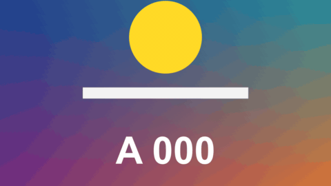

# Zoom Callout

特效 · 檔案 `templates/Effects/Zoom Callout.setting` · [回到總覽](../../README.md)

在畫面上的一個小地方畫個圈，拉兩條線到旁邊一個比較大的視窗，視窗裡是那個地方放大後的樣子。原本的畫面不動。適合教學、指出小細節。

**用法**：拖到片段上，把 `Look At` 移到要放大的地方，把 `Window Position` 移到畫面上空的地方。只想出現一小段時間，就先把那一段切出來再套。

| 參數 | 作用 |
|---|---|
| `Look At` | 要放大的那個點 |
| `Window Position` | 放大視窗的中心 |
| `Window Size` | 放大視窗的高度，以畫面高度為 1 |
| `Window Width / Height` | 視窗的寬高比，1 是圓形或正方形 |
| `Magnify` | 放大幾倍。來源那個小圈的大小是「視窗大小 ÷ 倍率」，會自動跟著變，圈到的範圍就是視窗裡看到的範圍 |
| `Corner Roundness` | 1 是圓形（或膠囊形），0 是矩形 |
| `Border Width` | 視窗外框的粗細，0 是沒有 |
| `Shadow` | 視窗周圍的陰影 |
| `Lines` | 連接線：`Two` 兩條、從小圈兩側拉到視窗兩側；`One` 一條；`None` 不畫 |
| `Line Width` | 連接線和小圈的粗細 |
| `Ring Around The Spot` | 要不要畫來源的小圈 |
| `Border And Line Colour` | 外框、連接線、小圈的顏色 |
| `Appears By` | `Growing Out Of The Spot` 從來源點長出來移到定位、`Fading In` 原地淡入 |
| `Appear (seconds)` | 出現花幾秒，0 是一開始就在 |
| `Fade Out (seconds)` | 結尾淡出花幾秒，0 是不淡出 |
| `Frame Rate Override` | 秒數算得不對時填時間軸的影格率，平常留 0 |

**注意**

- `Look At` 和 `Window Position` 都可以打關鍵幀。
- 放大是直接把原畫面拉大，倍率太高會糊。4K 素材放在 1080p 時間軸上會好一些。
- 和 [Spotlight](spotlight.md) 的差別：Spotlight 是在原地放大並把其他地方壓暗，這個是原畫面完全不動、另外開一個視窗。
