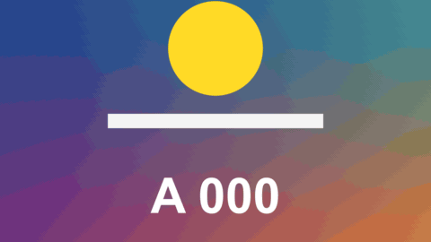

# Zoom Through

轉場 · 檔案 `templates/Transitions/Zoom Through.setting` · [回到總覽](../../README.md)

鏡頭往前一段裡面衝進去，衝出來時是下一段。兩段用同一個加速度放大，所以看起來是一個連續的推進（或拉遠）。

**用法**：拖到兩個片段的交界，拉成想要的長度。

| 參數 | 作用 |
|---|---|
| `Direction` | `Push In` 往裡衝，`Pull Out` 往後退 |
| `Zoom` | 總共放大幾倍 |
| `Zoom Center` | 往畫面上哪一點衝 |
| `Blur` | 最快那一刻放射狀模糊的程度 |
| `Snap` | 起步和煞車有多急 |
| `Cross Fade Length` | 兩段在中間交疊的長度。越小越像硬切 |
| `Twist` | 衝的途中畫面總共轉幾度，0 是不轉 |
| `Flash` | 最快那一刻變亮的程度，0 是關閉 |

**注意**

- 後一段是從縮小的狀態放大回來的，畫面外的部分用鏡像補上。`Zoom` 開很大時，中段會看到鏡像重複的圖樣，那一刻通常被模糊蓋住。
- 開頭和結尾那一格和原片段完全相同。
